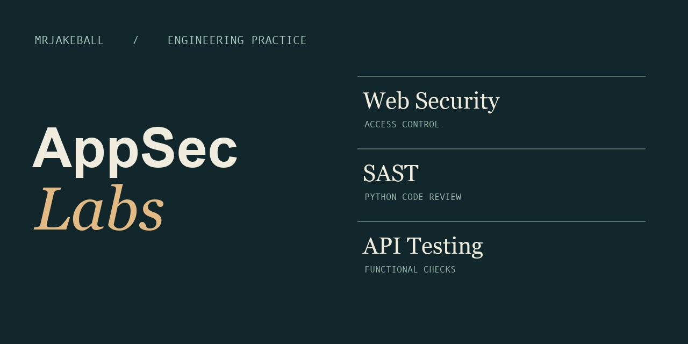

# AppSec Labs

Изучаю контроль доступа, статический анализ Python и функциональные проверки REST API. В отчётах собраны наблюдения, исходные материалы и выводы по каждому сценарию.

## Web Security

**[Unprotected Admin Functionality](portswigger/01-access-control/README.md)**  
Сервер принял административное действие без проверки роли. Проверку полномочий нужно выполнять для каждого привилегированного действия.

**[Unpredictable Admin URL](portswigger/02-unpredictable-admin-url/README.md)**  
Непредсказуемый адрес панели оказался доступен клиенту. Доступ к панели и её действиям должен зависеть от роли пользователя.

**[IDOR · User Profile](portswigger/03-idor-user-profile/README.md)**  
Сервер вернул данные чужого тестового профиля. При чтении записи нужно проверять право текущего пользователя именно на этот объект.

## SAST

**[Python eval() Security](sast/01-python-bandit/README.md)**  
Калькулятор перешёл от выполнения введённого выражения к разбору двух чисел и разрешённой операции. После исправления Bandit перестал выдавать B307.

**[OS Command Injection](sast/02-command-injection/README.md)**  
После перехода к списку аргументов Bandit перестал выдавать B602. Два предупреждения низкой важности остались и разобраны отдельно.

## API Testing

**[REST API Fundamentals](api-testing/01-rest-api-fundamentals/README.md)**  
Шесть HTTP-запросов, пять методов и 34 функциональные проверки. В сохранённом запуске прошли 34 из 34. Затем экспорт коллекции исправили. Повторный запуск исправленного файла пока не подтверждён.

## Материалы отчётов

В работах PortSwigger приложены подтверждения выполнения. В SAST можно сопоставить предупреждения с исправленным Python-кодом. В API Testing доступны коллекция Postman и снимок Collection Runner. Эта работа проверяет поведение учебного API.

[Профиль](https://github.com/mrjakeball) · [Каталог проектов](https://github.com/mrjakeball/portfolio)
