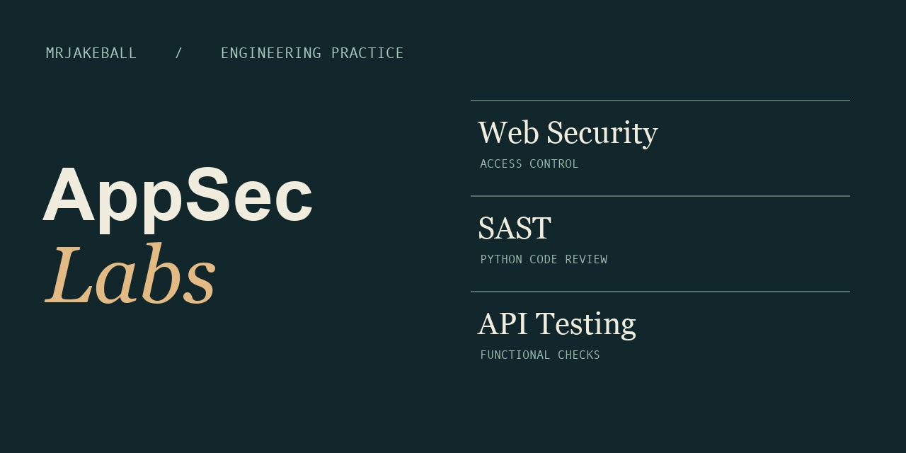

# AppSec Labs

I study access control, static analysis of Python and functional REST API testing. The reports document observations, evidence and conclusions for each scenario.

## Web Security

**[Unprotected Admin Functionality](portswigger/01-access-control/README_EN.md)**  
The server accepted an administrative action without checking the role. Each privileged action needs its own server-side authorization check.

**[Unpredictable Admin URL](portswigger/02-unpredictable-admin-url/README_EN.md)**  
The client could discover the panel’s unpredictable address. Access to both the panel and its actions must be decided by the user’s role.

**[IDOR · User Profile](portswigger/03-idor-user-profile/README_EN.md)**  
The server returned another test account’s profile. Reading a record requires a check that the current user is allowed to access that particular object.

## SAST

**[Python eval() Security](sast/01-python-bandit/README_EN.md)**  
The calculator now parses two numbers and an allowed operator. Bandit no longer reported B307 after that change.

**[OS Command Injection](sast/02-command-injection/README_EN.md)**  
After the change to an argument list, Bandit no longer reported B602. Two low-severity warnings remained and are documented separately.

## API Testing

**[REST API Fundamentals](api-testing/01-rest-api-fundamentals/README_EN.md)**  
Six HTTP requests, five methods and 34 functional assertions. The recorded run passed 34 of 34. The collection export was subsequently corrected. A run of that corrected file has yet to be confirmed.

## Reading the reports

The PortSwigger reports include completion evidence. In SAST, compare scanner findings with the revised Python implementation. API Testing includes the exported Postman collection and a Collection Runner screenshot documenting functional behaviour.

[Profile](https://github.com/mrjakeball/mrjakeball/blob/main/README_EN.md) · [Project catalogue](https://github.com/mrjakeball/portfolio/blob/main/README_EN.md)
