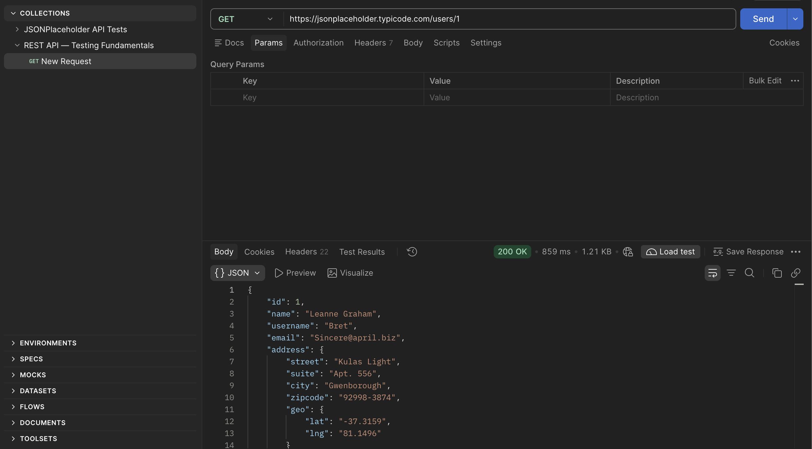
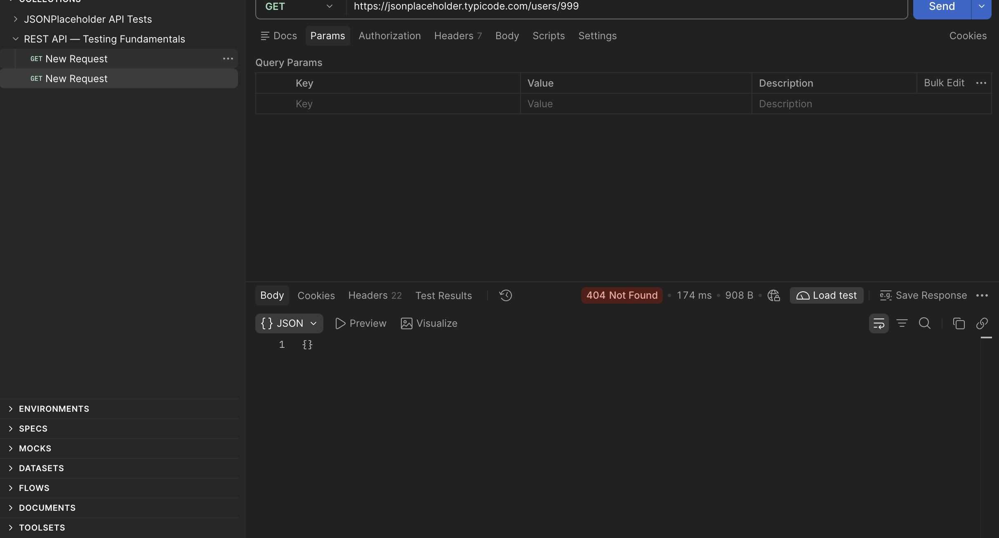
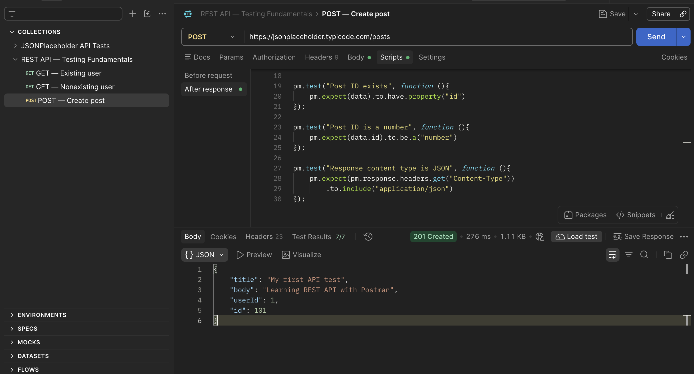
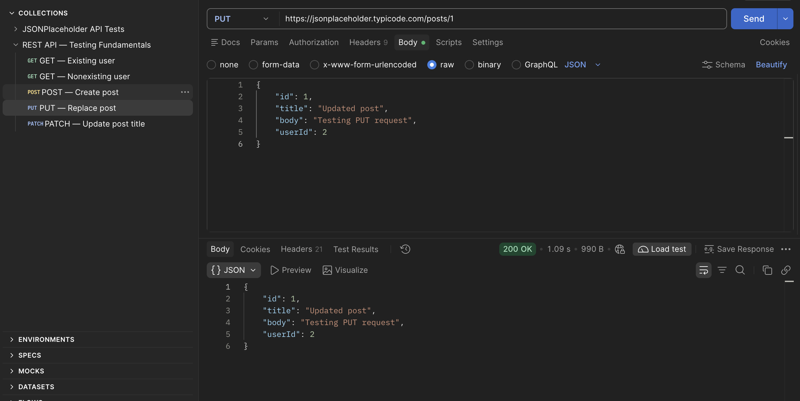
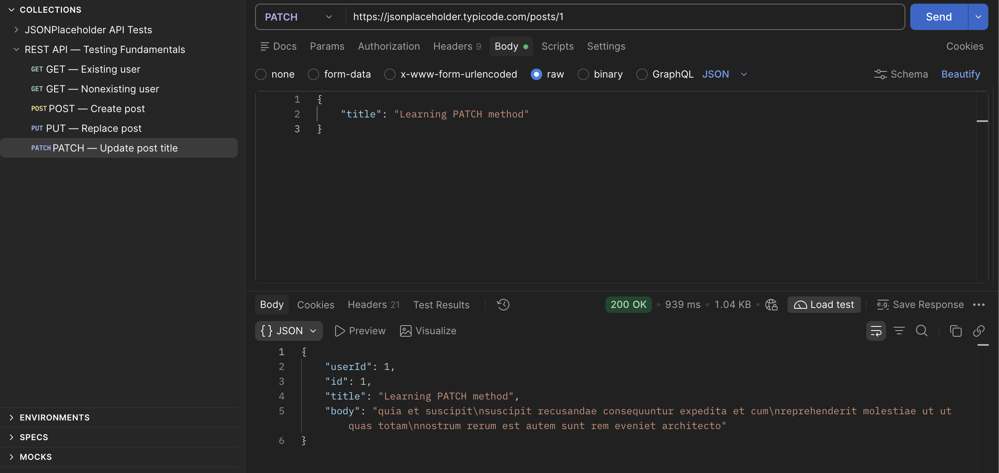
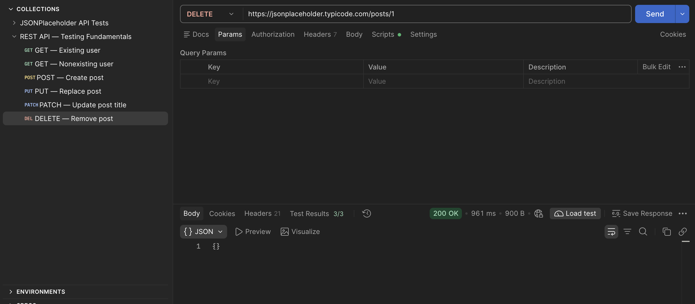
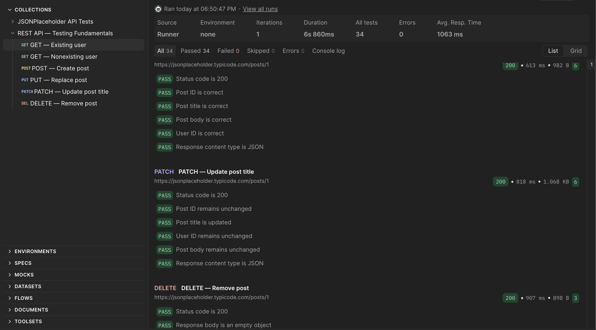

[AppSec Labs](../../README.md)　 /　 API Testing

# REST API Fundamentals

**Результат работы.** Шесть HTTP-запросов, пять методов и 34 функциональные проверки. В сохранённом запуске прошли 34 из 34. Затем экспорт коллекции исправили. Повторный запуск исправленного файла пока не подтверждён.

[Исходные скриншоты](assets/) · [Коллекция Postman](rest-api-tests.postman_collection.json)

## Цель работы

Изучить принципы взаимодействия с REST API, освоить основные HTTP-методы, научиться анализировать ответы сервера и создавать автоматические проверки в Postman с использованием JavaScript.

## Инструменты

- Postman
- JavaScript
- JSONPlaceholder REST API
- Visual Studio Code
- Git и GitHub
- macOS

## Объект тестирования

В качестве тестового сервиса использовался публичный демонстрационный REST API JSONPlaceholder.

Базовый URL: https://jsonplaceholder.typicode.com

Сервис предназначен для обучения и тестирования. Операции создания, обновления и удаления ресурсов имитируются без постоянного изменения данных на сервере.

## Тестовые сценарии

| Метод | Endpoint | Сценарий | Ожидаемый статус | Тестов |
|---|---|---|---|---:|
| GET | /users/1 | Получение существующего пользователя | 200 | 9 |
| GET | /users/999 | Получение несуществующего пользователя | 404 | 3 |
| POST | /posts | Создание публикации | 201 | 7 |
| PUT | /posts/1 | Полная замена публикации | 200 | 6 |
| PATCH | /posts/1 | Частичное обновление публикации | 200 | 6 |
| DELETE | /posts/1 | Удаление публикации | 200 | 3 |
| **Всего** | | | | **34** |

## 1. GET — получение существующего пользователя

Выполнен запрос GET /users/1.

Сервер вернул статус 200 OK и JSON-объект с данными пользователя.

Автоматические проверки:

- Статус-код 200.
- Корректность идентификатора пользователя.
- Корректность имени.
- Корректность username.
- Числовой тип ID.
- Строковый тип имени.
- Строковый тип электронной почты.
- Наличие поля email.
- Формат ответа application/json.

**Результат: 9/9 PASSED.**

Получение существующего пользователя

## 2. GET — негативное тестирование

Выполнен запрос GET /users/999 для получения несуществующего пользователя.

Сервер вернул статус 404 Not Found.

Автоматические проверки:

- Статус-код 404.
- Заголовок Content-Type содержит application/json.
- Тело ответа является пустым значением по проверке empty.

**Результат: 3/3 PASSED.**

Статус 404 является ожидаемым результатом негативного тестирования. Успешность теста определяется соответствием фактического результата ожидаемому, а не принадлежностью HTTP-статуса к группе 2xx.

Получение несуществующего пользователя

## 3. POST — создание публикации

Выполнен запрос POST /posts с передачей JSON-данных:

- title: My first API test
- body: Learning REST API with Postman
- userId: 1

Сервер вернул статус 201 Created и добавил идентификатор публикации.

Автоматические проверки:

- Статус-код 201.
- Корректность заголовка.
- Корректность содержимого публикации.
- Корректность ID автора.
- Наличие идентификатора созданного ресурса.
- Числовой тип идентификатора.
- Формат ответа application/json.

**Результат: 7/7 PASSED.**

Проверка идентификатора не привязана к конкретному значению 101, поскольку в реальных API идентификаторы новых ресурсов могут назначаться динамически.

Создание публикации

## 4. PUT — полная замена публикации

Выполнен запрос PUT /posts/1.

В теле запроса переданы все необходимые поля публикации, включая новый заголовок, содержимое и ID автора.

Автоматические проверки:

- Статус-код 200.
- ID публикации равен 1.
- Заголовок равен Updated post.
- Содержимое равно Testing PUT request.
- ID автора равен 2.
- Формат ответа application/json.

**Результат: 6/6 PASSED.**

Полная замена публикации

## 5. PATCH — частичное обновление публикации

Выполнен запрос PATCH /posts/1.

В теле запроса передано только поле title со значением Learning PATCH method.

Автоматические проверки:

- Статус-код 200.
- Идентификатор публикации не изменился.
- Заголовок соответствует новому значению.
- Идентификатор автора соответствует исходному значению.
- Содержимое публикации соответствует ожидаемому исходному тексту.
- Формат ответа application/json.

**Результат: 6/6 PASSED.**

Особое внимание уделено проверке отсутствия нежелательных изменений других полей в возвращаемом объекте.

Проверка только наличия поля недостаточна для подтверждения сохранения его содержимого. Поэтому использовалось сравнение с ожидаемым исходным значением.

Частичное обновление публикации

## 6. DELETE — удаление публикации

Выполнен запрос DELETE /posts/1 без тела запроса.

Сервер вернул статус 200 OK и пустой JSON-объект.

Автоматические проверки:

- Статус-код 200.
- Тело ответа равно пустому объекту.
- Формат ответа application/json.

**Результат: 3/3 PASSED.**

Удаление публикации

## Автоматизация тестирования

Автоматические проверки реализованы на JavaScript с использованием Postman Scripting API.

| Конструкция | Назначение |
|---|---|
| pm.test() | Создание теста |
| pm.response.json() | Разбор JSON-ответа |
| pm.response.to.have.status() | Проверка HTTP-статуса |
| pm.expect() | Формирование проверяемого условия |
| to.eql() | Проверка равенства |
| to.include() | Проверка содержимого |
| to.be.a() | Проверка типа данных |
| to.have.property() | Проверка наличия свойства |
| to.be.empty | Проверка пустого значения |
| pm.response.headers.get() | Получение HTTP-заголовка |

В процессе работы также выполнялась проверка корректности самих автоматических тестов. Была выявлена и исправлена ошибка, при которой тест с названием проверки email фактически проверял поле username.

Это продемонстрировало, что успешный результат теста не гарантирует корректность его реализации.

## Итоговый запуск Collection Runner

> Шесть HTTP-запросов, пять методов и 34 функциональные проверки. В сохранённом запуске прошли 34 из 34. Затем экспорт коллекции исправили. Повторный запуск исправленного файла пока не подтверждён.

Все шесть запросов выполнены последовательно в рамках одной итерации функционального тестирования.

| Показатель | Результат |
|---|---:|
| HTTP-запросов | 6 |
| HTTP-методов | 5 |
| Автоматических тестов | 34 |
| Passed | 34 |
| Failed | 0 |
| Skipped | 0 |
| Errors | 0 |
| Успешность | 100% |
| Продолжительность запуска | 6,860 с |
| Среднее время ответа | 1063 мс |

[Открыть оригинал](./assets/collection-run-results.png)

Время выполнения приведено для конкретного запуска и не является результатом нагрузочного тестирования.

## Как запустить тесты

1. Установить Postman.
2. Импортировать файл rest-api-tests.postman_collection.json.
3. Открыть коллекцию REST API — Testing Fundamentals.
4. Выбрать Run collection.
5. Установить Functional, Local и Iterations: 1.
6. Запустить коллекцию и ознакомиться с результатами.

## Полученные навыки

- Работа с REST API.
- Формирование HTTP-запросов.
- Анализ статус-кодов.
- Работа с HTTP-заголовками и JSON.
- Позитивное и негативное тестирование.
- Создание автоматических API-тестов на JavaScript.
- Проверка значений, типов и обязательных полей.
- Проверка отсутствия нежелательных изменений данных.
- Анализ корректности тестового кода.
- Запуск коллекций через Postman Collection Runner.

## Вывод

В ходе лабораторной работы были изучены пять основных HTTP-методов, реализованы шесть тестовых сценариев и выполнены 34 автоматические проверки.

В зафиксированном запуске прошли все 34 проверки.

Основной вывод: качественное тестирование API требует проверки не только HTTP-статуса, но и содержимого ответа, типов данных, обязательных полей и соответствия поведения сервера ожидаемому результату.

Успешное прохождение данной коллекции подтверждает соответствие проверенным функциональным ожиданиям, но не доказывает полную безопасность API или отсутствие других дефектов.

*Работа выполнена исключительно в образовательных целях с использованием публичного демонстрационного API.*

[Каталог отчётов](../../README.md) · [Профиль](https://github.com/mrjakeball) · [Каталог проектов](https://github.com/mrjakeball/portfolio)
