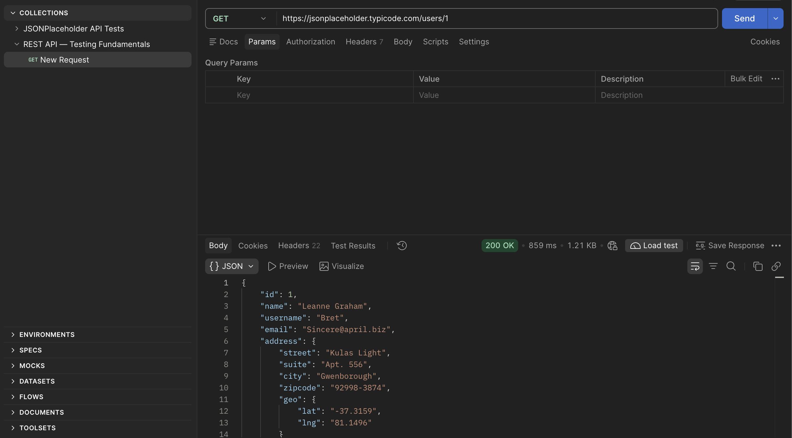
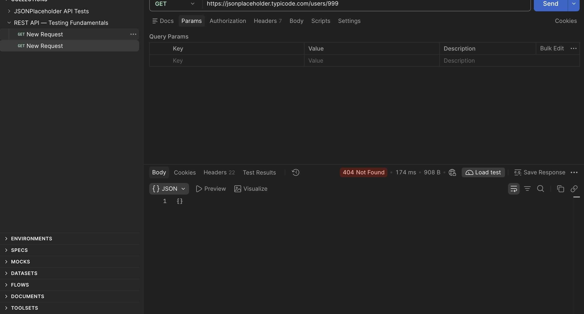
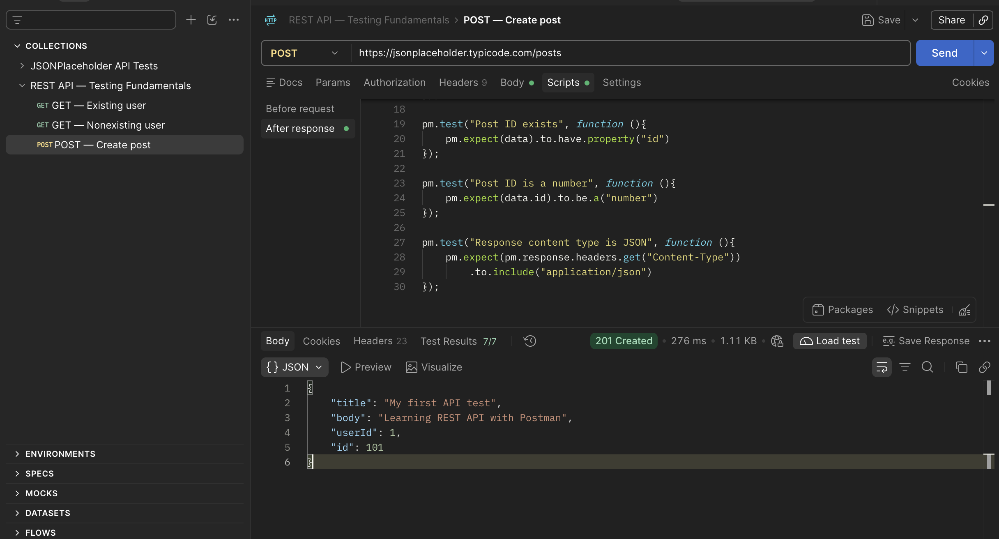
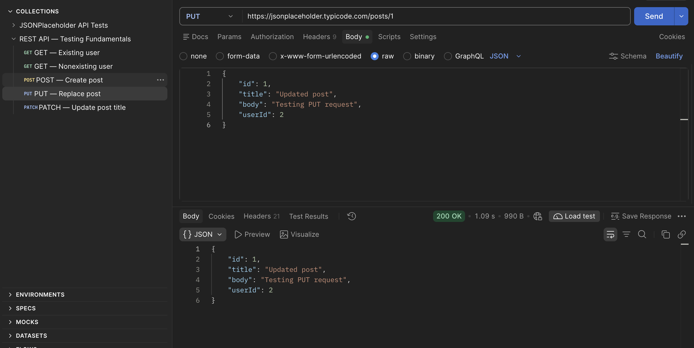
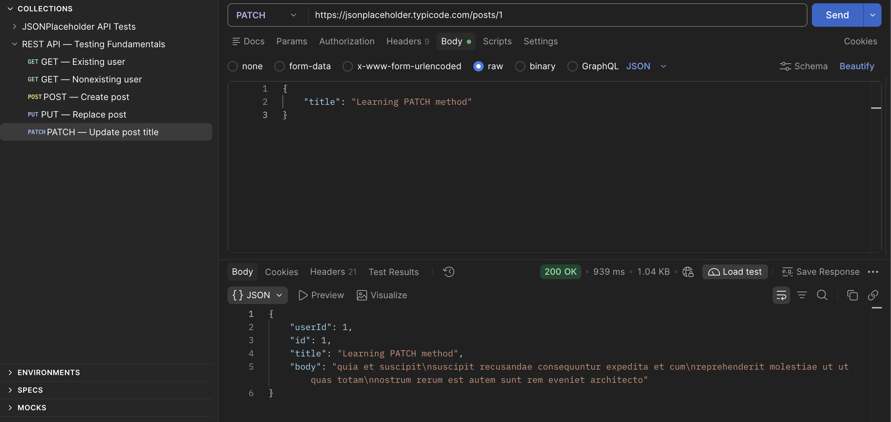
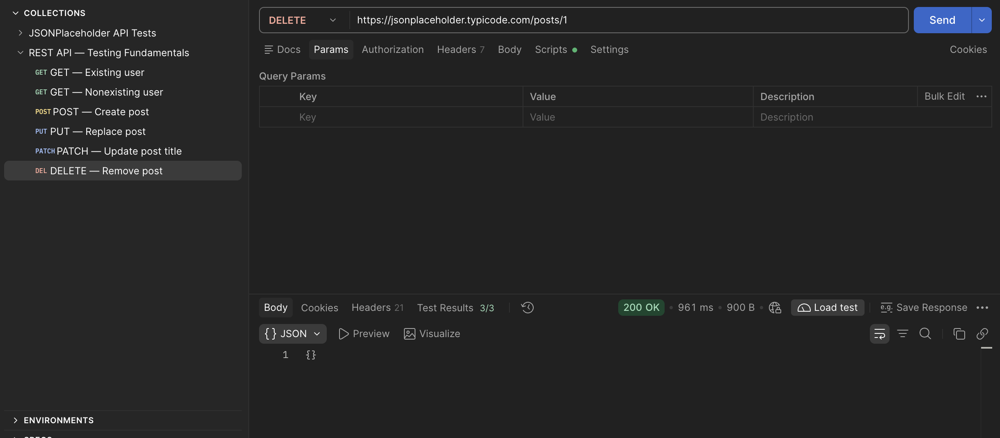
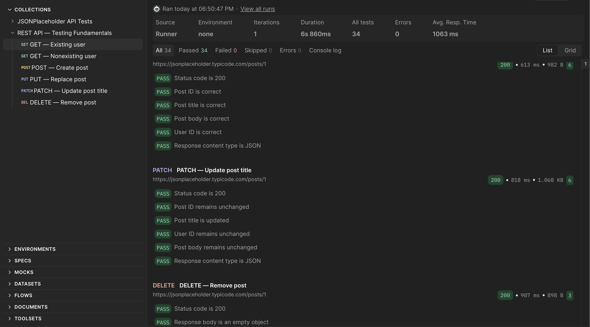

<a href="README.md"><picture><source media="(max-width: 600px)" srcset="https://raw.githubusercontent.com/mrjakeball/mrjakeball/df4dc8d1f2816fd3ce9d8c316b6ed728b5015d71/assets/navigation/ru-off-compact.svg"></picture></a>
<a href="README_EN.md"><picture><source media="(max-width: 600px)" srcset="https://raw.githubusercontent.com/mrjakeball/mrjakeball/df4dc8d1f2816fd3ce9d8c316b6ed728b5015d71/assets/navigation/en-on-compact.svg"></picture></a>
<a href="https://github.com/mrjakeball/portfolio/blob/main/README_EN.md"><picture><source media="(max-width: 600px)" srcset="https://raw.githubusercontent.com/mrjakeball/mrjakeball/df4dc8d1f2816fd3ce9d8c316b6ed728b5015d71/assets/navigation/catalog-en-compact.svg"></picture></a>

[AppSec Labs](../../README_EN.md)　 /　 API Testing

# REST API Fundamentals

**Recorded finding.** Six HTTP requests, five methods and 34 functional assertions. The recorded run passed 34 of 34. The collection export was subsequently corrected. A run of that corrected file has yet to be confirmed.

[Original screenshots](assets/) · [Postman collection](rest-api-tests.postman_collection.json)

## Objective

Understand REST API fundamentals, explore common HTTP methods, analyze server responses, and develop automated API tests using Postman and JavaScript.

## Tools

- Postman
- JavaScript
- JSONPlaceholder REST API
- Visual Studio Code
- Git and GitHub
- macOS

## Target API

JSONPlaceholder was used as a public demonstration REST API for educational testing.

Base URL: https://jsonplaceholder.typicode.com

The service simulates resource creation, updates, and deletion without permanently modifying server-side data.

## Test Scenarios

| Method | Endpoint | Scenario | Expected status | Tests |
|---|---|---|---|---:|
| GET | /users/1 | Retrieve an existing user | 200 | 9 |
| GET | /users/999 | Retrieve a nonexistent user | 404 | 3 |
| POST | /posts | Create a post | 201 | 7 |
| PUT | /posts/1 | Replace an existing post | 200 | 6 |
| PATCH | /posts/1 | Partially update a post | 200 | 6 |
| DELETE | /posts/1 | Remove a post | 200 | 3 |
| **Total** | | | | **34** |

## 1. GET — Retrieve an Existing User

A GET request was sent to /users/1.

The server returned 200 OK and a JSON object containing user information.

Automated checks:

- HTTP status code 200.
- Correct user ID.
- Correct name.
- Correct username.
- Numeric ID type.
- String name type.
- String email type.
- Presence of the email property.
- JSON response content type.

**Result: 9/9 PASSED.**

Retrieve an existing user

## 2. GET — Negative Testing

A GET request was sent to /users/999 to retrieve a nonexistent user.

The server returned 404 Not Found.

Automated checks:

- HTTP status code 404.
- Content-Type includes application/json.
- Response body passes the empty-value assertion.

**Result: 3/3 PASSED.**

The 404 status is an expected result in this negative test scenario. A test passes when the actual result matches the expected behavior, regardless of whether the HTTP response represents a success or an error status.

Retrieve a nonexistent user

## 3. POST — Create a Post

A POST request was sent to /posts with the following JSON data:

- title: My first API test
- body: Learning REST API with Postman
- userId: 1

The server returned 201 Created and added a post identifier.

Automated checks:

- HTTP status code 201.
- Correct post title.
- Correct post body.
- Correct user ID.
- Presence of the generated post ID.
- Numeric post ID type.
- JSON response content type.

**Result: 7/7 PASSED.**

The generated identifier was not restricted to the specific value 101 because real-world APIs may assign resource identifiers dynamically.

Create a post

## 4. PUT — Replace a Post

A PUT request was sent to /posts/1.

The request body contained the complete intended representation of the post, including its updated title, content, and user ID.

Automated checks:

- HTTP status code 200.
- Post ID equals 1.
- Post title equals Updated post.
- Post body equals Testing PUT request.
- User ID equals 2.
- JSON response content type.

**Result: 6/6 PASSED.**

Replace an existing post

## 5. PATCH — Partially Update a Post

A PATCH request was sent to /posts/1.

Only the title property was provided in the request body, with the value Learning PATCH method.

Automated checks:

- HTTP status code 200.
- Post ID remains unchanged.
- Post title matches the updated value.
- User ID matches the original expected value.
- Post body matches the original expected content.
- JSON response content type.

**Result: 6/6 PASSED.**

Special attention was given to detecting unintended changes in the other properties of the returned object.

Checking the presence of a property alone is insufficient to demonstrate that its value remains unchanged. Therefore, equality assertions were used to validate the expected original content.

Partially update a post

## 6. DELETE — Remove a Post

A DELETE request was sent to /posts/1 without a request body.

The server returned 200 OK and an empty JSON object.

Automated checks:

- HTTP status code 200.
- Response body equals an empty object.
- JSON response content type.

**Result: 3/3 PASSED.**

Remove a post

## Test Automation

Automated checks were implemented in JavaScript using the Postman Scripting API.

| Construct | Purpose |
|---|---|
| pm.test() | Define a test |
| pm.response.json() | Parse a JSON response |
| pm.response.to.have.status() | Validate the HTTP status |
| pm.expect() | Define an assertion target |
| to.eql() | Validate equality |
| to.include() | Validate contained values |
| to.be.a() | Validate data types |
| to.have.property() | Validate property existence |
| to.be.empty | Validate empty values |
| pm.response.headers.get() | Retrieve HTTP headers |

The test implementation itself was also reviewed. During development, an incorrectly implemented email test was identified: its assertion checked the username property instead of the email property.

The assertion was corrected, demonstrating that passing tests do not necessarily guarantee correct test logic.

## Collection Runner Results

> Six HTTP requests, five methods and 34 functional assertions. The recorded run passed 34 of 34. The collection export was subsequently corrected. A run of that corrected file has yet to be confirmed.

All six requests were executed sequentially in a single functional testing iteration.

| Metric | Result |
|---|---:|
| HTTP requests | 6 |
| HTTP methods | 5 |
| Automated tests | 34 |
| Passed | 34 |
| Failed | 0 |
| Skipped | 0 |
| Errors | 0 |
| Pass rate | 100% |
| Run duration | 6.860 s |
| Average response time | 1063 ms |

[View original](./assets/collection-run-results.png)

Execution times represent a single collection run and should not be interpreted as load testing results.

## How to Run

1. Install Postman.
2. Import rest-api-tests.postman_collection.json.
3. Open the REST API — Testing Fundamentals collection.
4. Select Run collection.
5. Choose Functional, Local, and one iteration.
6. Start the collection run and review the results.

## Skills Acquired

- REST API fundamentals.
- HTTP request construction.
- HTTP status code analysis.
- JSON and HTTP header validation.
- Positive and negative testing.
- JavaScript-based API test automation.
- Value, type, and required property validation.
- Detection of unintended data changes.
- Review and correction of automated test logic.
- Collection execution using Postman Collection Runner.

## Conclusion

This lab covered five common HTTP methods, six API testing scenarios, and 34 automated assertions.

All 34 assertions passed in the recorded run, before the collection export was corrected.

The main takeaway is that effective API testing requires more than checking HTTP status codes. Response content, data types, required properties, and expected application behavior must also be validated.

A successful collection run demonstrates compliance with the tested functional expectations but does not prove that the API is completely secure or free of other defects.

*This lab was conducted solely for educational purposes using a public demonstration API.*

[Report catalogue](../../README_EN.md) · [Profile](https://github.com/mrjakeball/mrjakeball/blob/main/README_EN.md) · [Project catalogue](https://github.com/mrjakeball/portfolio/blob/main/README_EN.md)
