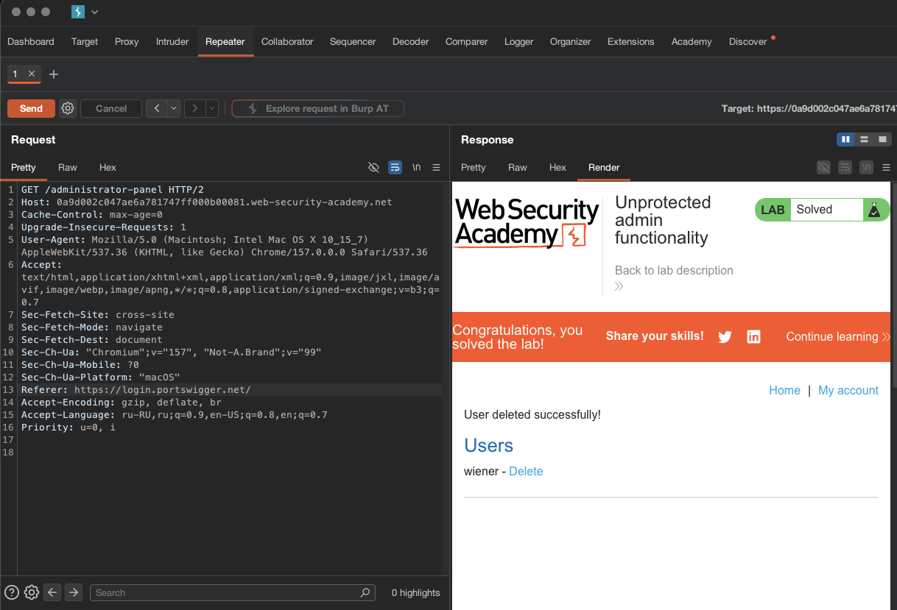

<a href="README.md"><picture><source media="(max-width: 600px)" srcset="https://raw.githubusercontent.com/mrjakeball/mrjakeball/df4dc8d1f2816fd3ce9d8c316b6ed728b5015d71/assets/navigation/ru-on-compact.svg"></picture></a>
<a href="README_EN.md"><picture><source media="(max-width: 600px)" srcset="https://raw.githubusercontent.com/mrjakeball/mrjakeball/df4dc8d1f2816fd3ce9d8c316b6ed728b5015d71/assets/navigation/en-off-compact.svg"></picture></a>
<a href="https://github.com/mrjakeball/portfolio"><picture><source media="(max-width: 600px)" srcset="https://raw.githubusercontent.com/mrjakeball/mrjakeball/df4dc8d1f2816fd3ce9d8c316b6ed728b5015d71/assets/navigation/catalog-ru-compact.svg"></picture></a>

[AppSec Labs](../../README.md)　 /　 Web Security

# Unprotected Admin Functionality

**Результат работы.** Сервер принял административное действие без проверки роли. Проверку полномочий нужно выполнять для каждого привилегированного действия.

PortSwigger Web Security Academy · Apprentice · Burp Suite Community

[Исходные скриншоты](assets/) · [PortSwigger](https://portswigger.net/web-security/access-control/lab-unprotected-admin-functionality)

## Цель лабораторной

Обнаружить административную панель, доступ к которой не защищён должным образом, и подтвердить возможность выполнения привилегированных действий без административных прав.

Для успешного завершения лабораторной необходимо удалить тестового пользователя `carlos`.

## Обнаруженная уязвимость

**Тип:** Broken Access Control — нарушение контроля доступа.

В приложении отсутствует надлежащая серверная проверка полномочий при обращении к административной панели и функции удаления пользователей.

Адрес административного интерфейса дополнительно раскрывается через публичный файл `robots.txt`.

### Возможные последствия

- Несанкционированный доступ к административному интерфейсу.
- Просмотр списка пользователей.
- Удаление учётных записей без необходимых полномочий.
- Нарушение целостности данных приложения.

Само наличие адреса в `robots.txt` не является основной уязвимостью. Критическая проблема заключается в отсутствии надлежащей проверки прав доступа на сервере.

## Использованные инструменты

- **Burp Suite Community Edition** — анализ HTTP-трафика.
- **Proxy → HTTP History** — исследование запросов приложения.
- **Repeater** — ручное изменение и повторная отправка запросов.
- **Burp Browser** — взаимодействие с учебным веб-приложением.

## Ход выполнения

### Шаг 1. Анализ HTTP-трафика

Учебный интернет-магазин был открыт через встроенный браузер Burp Suite.

Во вкладке **Proxy → HTTP History** обнаружен запрос главной страницы.

**Запрос:** `GET /`  
**Ответ сервера:** `200 OK`  
**Тип содержимого:** `text/html`

### Шаг 2. Проверка robots.txt

Через Burp Repeater был отправлен запрос:

`GET /robots.txt`

**Ответ сервера:** `200 OK`

Содержимое файла:

`User-agent: *`

`Disallow: /administrator-panel`

Файл раскрыл путь к потенциально защищённой административной панели.

### Шаг 3. Проверка административного интерфейса

В Repeater был отправлен запрос:

`GET /administrator-panel`

**Ответ сервера:** `200 OK`

Сервер вернул HTML-страницу административного интерфейса со списком пользователей и ссылками на удаление учётных записей.

Доступ к панели оказался возможен без административной авторизации.

### Шаг 4. Анализ функции удаления

В исходном HTML-коде страницы была обнаружена ссылка:

`/administrator-panel/delete?username=carlos`

Удаление выполнялось через HTTP-метод GET, предназначенный для получения ресурсов, а не для операций, изменяющих состояние приложения.

### Шаг 5. Подтверждение уязвимости

В рамках разрешённого учебного стенда отправлен запрос:

`GET /administrator-panel/delete?username=carlos`

**Ответ сервера:** `302 Found`

После выполнения запроса:

- Пользователь `carlos` исчез из списка.
- Приложение отобразило сообщение `User deleted successfully!`.
- Лабораторная получила статус **Solved**.

Это подтвердило возможность выполнения административной операции без необходимых прав.

## Подтверждение выполнения

Ниже представлен скриншот из Burp Suite Repeater, сделанный после выполнения лабораторной.

[Открыть оригинал](./assets/lab-01-solved.png)

*Результат: Lab Solved. Пользователь carlos удалён. Скриншот показывает итоговое состояние административного интерфейса.*

## Рекомендации по исправлению

1. **Аутентификация.** Требовать подтверждения личности пользователя перед доступом к административным функциям.
2. **Авторизация.** Проверять административные полномочия на сервере при каждом обращении к защищённым endpoint.
3. **Защита операций.** Ограничить удаление пользователей только учётными записями с соответствующими правами.
4. **HTTP-методы.** Использовать POST или DELETE вместо GET для операций удаления.
5. **Защита от CSRF.** Применять необходимые меры защиты для операций, изменяющих состояние приложения.
6. **Безопасная конфигурация.** Не полагаться на скрытые URL или `robots.txt` как на механизм контроля доступа.

**Основной принцип:** права доступа необходимо проверять на стороне сервера, независимо от интерфейса или способа отправки запроса.

## Результат

**Лабораторная успешно выполнена.**

В ходе работы получен практический опыт:

- Анализа HTTP-запросов и ответов.
- Использования Burp Suite Proxy и Repeater.
- Исследования служебных ресурсов веб-приложения.
- Обнаружения нарушений контроля доступа.
- Подтверждения и документирования уязвимостей.

**Уровень самостоятельности:** выполнено с обучающими подсказками.

*Все действия выполнялись исключительно в разрешённой учебной среде PortSwigger Web Security Academy.*

[Каталог отчётов](../../README.md) · [Профиль](https://github.com/mrjakeball) · [Каталог проектов](https://github.com/mrjakeball/portfolio)
