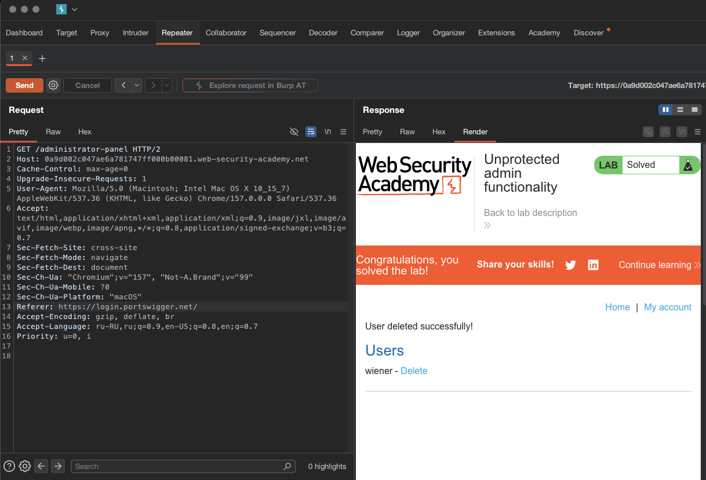

<a href="README.md"><picture><source media="(max-width: 600px)" srcset="https://raw.githubusercontent.com/mrjakeball/mrjakeball/df4dc8d1f2816fd3ce9d8c316b6ed728b5015d71/assets/navigation/ru-off-compact.svg"></picture></a>
<a href="README_EN.md"><picture><source media="(max-width: 600px)" srcset="https://raw.githubusercontent.com/mrjakeball/mrjakeball/df4dc8d1f2816fd3ce9d8c316b6ed728b5015d71/assets/navigation/en-on-compact.svg"></picture></a>
<a href="https://github.com/mrjakeball/portfolio/blob/main/README_EN.md"><picture><source media="(max-width: 600px)" srcset="https://raw.githubusercontent.com/mrjakeball/mrjakeball/df4dc8d1f2816fd3ce9d8c316b6ed728b5015d71/assets/navigation/catalog-en-compact.svg"></picture></a>

[AppSec Labs](../../README_EN.md)　 /　 Web Security

# Unprotected Admin Functionality

**Recorded finding.** The server accepted an administrative action without checking the role. Each privileged action needs its own server-side authorization check.

PortSwigger Web Security Academy · Apprentice · Burp Suite Community

[Original screenshots](assets/) · [PortSwigger](https://portswigger.net/web-security/access-control/lab-unprotected-admin-functionality)

## Objective

Identify an administrative interface with insufficient access control and demonstrate that privileged actions can be performed without administrator privileges.

The objective of this lab was to delete the test user `carlos`.

## Identified Vulnerability

**Type:** Broken Access Control — Unprotected Administrative Functionality.

The application fails to enforce proper server-side authorization checks on the administrative panel and user deletion functionality.

The location of the administrative interface is also disclosed through the publicly accessible `robots.txt` file.

### Potential Impact

- Unauthorized access to administrative functionality.
- Exposure of the user list.
- Unauthorized deletion of user accounts.
- Compromise of application data integrity.

Disclosing a path in `robots.txt` is not the primary vulnerability. The critical issue is the lack of proper server-side access control.

## Tools Used

- **Burp Suite Community Edition** — HTTP traffic analysis.
- **Proxy → HTTP History** — inspection of application requests.
- **Repeater** — manual modification and replay of HTTP requests.
- **Burp Browser** — interaction with the training application.

## Testing Process

### Step 1. HTTP Traffic Analysis

Opened the training application using Burp Suite's built-in browser.

Identified the homepage request through **Proxy → HTTP History**.

**Request:** `GET /`  
**Server Response:** `200 OK`  
**Content Type:** `text/html`

### Step 2. Inspecting robots.txt

Sent the following request using Burp Repeater:

`GET /robots.txt`

**Server Response:** `200 OK`

The file contained:

`User-agent: *`

`Disallow: /administrator-panel`

This revealed the location of a potentially sensitive administrative interface.

### Step 3. Testing Administrative Access

Sent the following request using Repeater:

`GET /administrator-panel`

**Server Response:** `200 OK`

The server returned an HTML administrative interface containing a user list and account deletion links.

The interface was accessible without administrator authentication.

### Step 4. Inspecting the Deletion Function

The following link was identified in the HTML source:

`/administrator-panel/delete?username=carlos`

The application used the HTTP GET method for a destructive operation, contrary to HTTP safe-method semantics.

### Step 5. Confirming the Vulnerability

Within the authorized training environment, the following request was sent:

`GET /administrator-panel/delete?username=carlos`

**Server Response:** `302 Found`

After sending the request:

- The user `carlos` disappeared from the user list.
- The application displayed `User deleted successfully!`.
- PortSwigger marked the lab as **Solved**.

This confirmed that an administrative operation could be performed without the required privileges.

## Proof of Completion

The following screenshot was captured in Burp Suite Repeater after completing the lab.

[View original](./assets/lab-01-solved.png)

*Result: Lab Solved. User carlos was deleted. The screenshot shows the final state of the administrative interface.*

## Remediation Recommendations

1. **Authentication.** Require users to authenticate before accessing administrative functionality.
2. **Authorization.** Enforce server-side administrator privilege checks on every protected endpoint.
3. **Operation Security.** Restrict user deletion to accounts with explicitly granted administrative privileges.
4. **HTTP Methods.** Use POST or DELETE instead of GET for destructive operations.
5. **CSRF Protection.** Apply appropriate CSRF defenses to state-changing requests.
6. **Secure Configuration.** Never rely on hidden URLs or `robots.txt` as a security mechanism.

**Key Principle:** Access control must be enforced on the server regardless of the user interface or HTTP client.

## Result

**Lab successfully completed.**

Practical skills gained:

- HTTP request and response analysis.
- Working with Burp Suite Proxy and Repeater.
- Discovering exposed application resources.
- Identifying Broken Access Control vulnerabilities.
- Validating and documenting security findings.

**Independence level:** completed with guided learning hints.

*All testing was performed exclusively within the authorized PortSwigger Web Security Academy environment.*

[Report catalogue](../../README_EN.md) · [Profile](https://github.com/mrjakeball/mrjakeball/blob/main/README_EN.md) · [Project catalogue](https://github.com/mrjakeball/portfolio/blob/main/README_EN.md)
