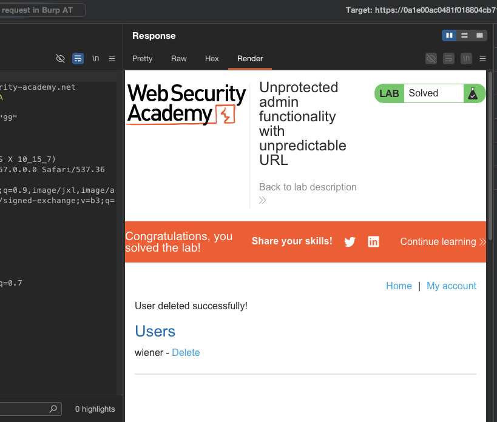

<a href="README.md"><picture><source media="(max-width: 600px)" srcset="https://raw.githubusercontent.com/mrjakeball/mrjakeball/main/assets/navigation/ru-on-compact.svg?v=2"></picture></a>
<a href="README_EN.md"><picture><source media="(max-width: 600px)" srcset="https://raw.githubusercontent.com/mrjakeball/mrjakeball/main/assets/navigation/en-off-compact.svg?v=2"></picture></a>
<a href="https://github.com/mrjakeball/portfolio"><picture><source media="(max-width: 600px)" srcset="https://raw.githubusercontent.com/mrjakeball/mrjakeball/main/assets/navigation/catalog-ru-compact.svg?v=2"></picture></a>

[AppSec Labs](../../README.md)　 /　 Web Security

# Unpredictable Admin URL

**Результат работы.** Непредсказуемый адрес панели оказался доступен клиенту. Доступ к панели и её действиям должен зависеть от роли пользователя.

PortSwigger Web Security Academy · Apprentice · Burp Suite Community

[Исходные скриншоты](assets/) · [PortSwigger](https://portswigger.net/web-security/access-control/lab-unprotected-admin-functionality-with-unpredictable-url)

## Цель лабораторной

Обнаружить административный интерфейс, адрес которого невозможно легко угадать, и проверить безопасность доступа к его функциям.

Для успешного завершения лабораторной необходимо найти административную панель и удалить тестового пользователя `carlos`.

## Обнаруженная уязвимость

**Тип:** Broken Access Control — нарушение контроля доступа.

Приложение скрывает ссылку на административную панель с помощью клиентской JavaScript-логики, однако её адрес присутствует в исходном HTML-коде страницы.

При этом сервер не обеспечивает надлежащую проверку административных полномочий для доступа к защищённой функциональности.

### Возможные последствия

- Обнаружение скрытых административных разделов.
- Несанкционированный доступ к административным функциям.
- Просмотр списка пользователей.
- Удаление учётных записей без соответствующих полномочий.

**Ключевая проблема:** скрытый или непредсказуемый URL не заменяет серверную проверку прав доступа.

## Использованные инструменты

- **Burp Suite Community Edition** — ручное исследование веб-приложения.
- **Proxy → HTTP History** — просмотр сетевого трафика.
- **Repeater** — изменение HTTP-запросов и анализ ответов.
- **Burp Browser** — взаимодействие с учебным приложением.

## Ход выполнения

### Шаг 1. Анализ приложения

Открыл лабораторную во встроенном браузере Burp Suite.

В **Proxy → HTTP History** нашёл запрос главной страницы учебного магазина.

**Запрос:** `GET /`  
**Ответ:** `200 OK`

Изучил HTML-код ответа сервера, уделяя внимание JavaScript и потенциальным административным функциям.

### Шаг 2. Исследование JavaScript-кода

В исходном коде главной страницы обнаружил JavaScript-фрагмент, содержащий проверку `isAdmin`.

Код создавал ссылку на административную панель при выполнении условия `isAdmin`.

В исследованном экземпляре лаборатории был раскрыт путь:

`/admin-d5fvta`

Адрес присутствовал в клиентском коде независимо от того, отображалась ли ссылка обычному пользователю.

### Шаг 3. Проверка административного пути

Через Burp Repeater отправил запрос:

`GET /admin-d5fvta`

**Ответ:** `200 OK`  
**Content-Type:** `text/html`

Сервер вернул административный интерфейс со списком пользователей и ссылками удаления.

Это подтвердило доступность административной функциональности без надлежащей проверки привилегий.

### Шаг 4. Исправление тестового запроса

При первоначальном исследовании возникли ошибки `404 Not Found` и `Communication error`.

Дополнительная проверка выявила некорректную структуру вручную изменённого HTTP-запроса.

Для устранения проблемы был повторно взят корректный запрос из **HTTP History**, после чего в Repeater изменён только путь.

Повторная отправка завершилась успешным ответом `200 OK`.

### Шаг 5. Подтверждение уязвимости

Проанализировал административную страницу и обнаружил функцию удаления пользователей.

В рамках разрешённой учебной среды выполнил удаление тестового пользователя `carlos`.

**Результат:**

- Сервер отобразил `User deleted successfully!`.
- Пользователь `carlos` исчез из списка.
- PortSwigger присвоил лабораторной статус **Solved**.

## Подтверждение выполнения

  

*Скриншот результата: Lab Solved, подтверждённое удаление тестового пользователя. Данные сессии скрыты.*

## Рекомендации по исправлению

1. **Серверная авторизация.** Проверять административные привилегии на каждом защищённом endpoint.
2. **Контроль доступа по ролям.** Разрешать выполнение административных действий только уполномоченным пользователям.
3. **Защита операций удаления.** Отдельно проверять полномочия непосредственно перед выполнением критических действий.
4. **Безопасная обработка ошибок.** Возвращать отказ в доступе при отсутствии прав, не выполняя административную операцию.
5. **Клиентский код.** Не считать скрытие ссылок через JavaScript механизмом безопасности.
6. **Тестирование.** Добавить проверки, подтверждающие невозможность доступа к административным функциям из обычной пользовательской сессии.

## Результат

**Лабораторная успешно выполнена.**

### Полученные навыки

- Анализ HTML и JavaScript-кода.
- Поиск скрытых административных маршрутов.
- Использование Burp Proxy и Repeater.
- Диагностика ошибок HTTP-запросов.
- Проверка серверного контроля доступа.
- Документирование уязвимостей.

**Уровень самостоятельности:** административный путь найден самостоятельно; при исправлении HTTP-запроса использовались подсказки наставника.

*Все действия выполнялись исключительно в разрешённой учебной среде PortSwigger Web Security Academy.*

[Каталог отчётов](../../README.md) · [Профиль](https://github.com/mrjakeball) · [Каталог проектов](https://github.com/mrjakeball/portfolio)
