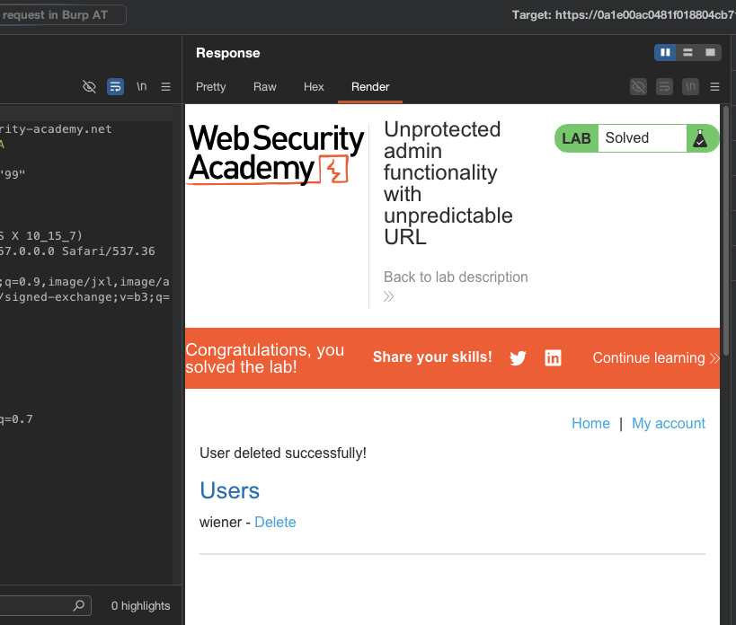

<a href="README.md"><picture><source media="(max-width: 600px)" srcset="https://raw.githubusercontent.com/mrjakeball/mrjakeball/main/assets/navigation/ru-off-compact.svg?v=2"></picture></a>
<a href="README_EN.md"><picture><source media="(max-width: 600px)" srcset="https://raw.githubusercontent.com/mrjakeball/mrjakeball/main/assets/navigation/en-on-compact.svg?v=2"></picture></a>
<a href="https://github.com/mrjakeball/portfolio/blob/main/README_EN.md"><picture><source media="(max-width: 600px)" srcset="https://raw.githubusercontent.com/mrjakeball/mrjakeball/main/assets/navigation/catalog-en-compact.svg?v=2"></picture></a>

[AppSec Labs](../../README_EN.md)　 /　 Web Security

# Unpredictable Admin URL

**Recorded finding.** The client could discover the panel’s unpredictable address. Access to both the panel and its actions must be decided by the user’s role.

PortSwigger Web Security Academy · Apprentice · Burp Suite Community

[Original screenshots](assets/) · [PortSwigger](https://portswigger.net/web-security/access-control/lab-unprotected-admin-functionality-with-unpredictable-url)

## Objective

Discover an administrative interface with an unpredictable URL and evaluate whether its functionality is properly protected.

The objective was to locate the administrative panel and delete the test user `carlos`.

## Identified Vulnerability

**Type:** Broken Access Control — Unprotected Administrative Functionality.

The application uses client-side JavaScript to hide the administrative panel link. However, the administrative URL remains exposed in the HTML source.

The server also fails to properly enforce administrator-level authorization for the protected functionality.

### Potential Impact

- Discovery of hidden administrative endpoints.
- Unauthorized access to administrative functionality.
- Exposure of user management information.
- Unauthorized deletion of user accounts.

**Key finding:** An unpredictable URL does not replace proper server-side access control.

## Tools Used

- **Burp Suite Community Edition** — manual web application security testing.
- **Proxy → HTTP History** — inspection of HTTP traffic.
- **Repeater** — modification and replay of HTTP requests.
- **Burp Browser** — interaction with the training application.

## Testing Process

### Step 1. Application Reconnaissance

Opened the training application using Burp Suite's built-in browser.

Identified the homepage request through **Proxy → HTTP History**.

**Request:** `GET /`  
**Response:** `200 OK`

Inspected the HTML response and examined JavaScript-related functionality.

### Step 2. JavaScript Source Analysis

Identified JavaScript code referencing an `isAdmin` condition.

The script was responsible for dynamically adding a link to the administrative panel when the condition was satisfied.

The examined lab instance exposed the following path:

`/admin-d5fvta`

The administrative endpoint was visible in the client-side source even when the link was not displayed to ordinary users.

### Step 3. Testing the Administrative Endpoint

Used Burp Repeater to send:

`GET /admin-d5fvta`

**Response:** `200 OK`  
**Content-Type:** `text/html`

The server returned an administrative interface containing a user list and deletion functionality.

This demonstrated that the administrative functionality was not protected by sufficient server-side authorization.

### Step 4. Troubleshooting the HTTP Request

Initial testing resulted in `404 Not Found` and `Communication error` responses.

Further inspection identified a malformed manually edited HTTP request.

To resolve the issue, a valid request was copied from **HTTP History** into Repeater, and only the request path was modified.

The corrected request successfully returned `200 OK`.

### Step 5. Confirming the Vulnerability

Inspected the administrative interface and identified the user deletion functionality.

Within the authorized training environment, deleted the test user `carlos`.

**Result:**

- The application displayed `User deleted successfully!`.
- The user `carlos` disappeared from the user list.
- PortSwigger marked the laboratory as **Solved**.

## Proof of Completion

  

*Final result: Lab Solved, confirming the successful deletion of the test user. Session data has been hidden.*

## Remediation Recommendations

1. **Server-side authorization.** Enforce administrator privilege checks on every protected endpoint.
2. **Role-based access control.** Restrict administrative operations to authorized accounts.
3. **Sensitive operations.** Validate permissions again before performing destructive actions.
4. **Secure error handling.** Deny unauthorized requests without executing administrative functionality.
5. **Client-side security.** Never treat JavaScript-based link hiding as an access-control mechanism.
6. **Security testing.** Add tests verifying that ordinary user sessions cannot access administrative endpoints.

## Result

**Lab successfully completed.**

### Skills Practiced

- HTML and JavaScript source analysis.
- Discovering hidden administrative endpoints.
- Using Burp Suite Proxy and Repeater.
- Troubleshooting malformed HTTP requests.
- Testing server-side access control.
- Documenting security findings.

**Independence level:** discovered the administrative path independently; received guidance while troubleshooting the HTTP request.

*All testing was performed exclusively within the authorized PortSwigger Web Security Academy environment.*

[Report catalogue](../../README_EN.md) · [Profile](https://github.com/mrjakeball/mrjakeball/blob/main/README_EN.md) · [Project catalogue](https://github.com/mrjakeball/portfolio/blob/main/README_EN.md)
