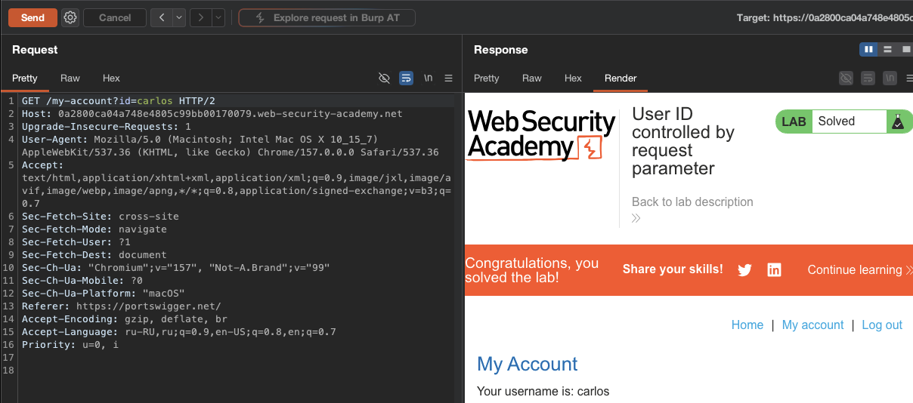

<a href="README.md"><picture><source media="(max-width: 600px)" srcset="https://raw.githubusercontent.com/mrjakeball/mrjakeball/main/assets/navigation/ru-on-compact.svg?v=2"></picture></a>
<a href="README_EN.md"><picture><source media="(max-width: 600px)" srcset="https://raw.githubusercontent.com/mrjakeball/mrjakeball/main/assets/navigation/en-off-compact.svg?v=2"></picture></a>
<a href="https://github.com/mrjakeball/portfolio"><picture><source media="(max-width: 600px)" srcset="https://raw.githubusercontent.com/mrjakeball/mrjakeball/main/assets/navigation/catalog-ru-compact.svg?v=2"></picture></a>

[AppSec Labs](../../README.md)　 /　 Web Security

# IDOR · User Profile

**Результат работы.** Сервер вернул данные чужого тестового профиля. При чтении записи нужно проверять право текущего пользователя именно на этот объект.

PortSwigger Web Security Academy · Apprentice · Burp Suite Community

[Исходные скриншоты](assets/) · [PortSwigger](https://portswigger.net/web-security/access-control/lab-user-id-controlled-by-request-parameter)

## Цель лабораторной

Исследовать механизм доступа к пользовательским профилям и обнаружить уязвимость, позволяющую одному авторизованному пользователю получить конфиденциальные данные другого.

Для успешного завершения лабораторной необходимо получить API-ключ тестового пользователя `carlos`, используя учётную запись `wiener`.

## Обнаруженная уязвимость

**Тип:** Insecure Direct Object Reference (IDOR) — небезопасная прямая ссылка на объект.

**Категория:** Broken Access Control — нарушение контроля доступа.

**Механизм:** Horizontal Privilege Escalation — горизонтальное повышение привилегий.

Приложение использует параметр `id` в URL для определения пользовательского профиля, который необходимо отобразить.

При этом сервер недостаточно проверяет, имеет ли текущий пользователь право просматривать запрашиваемый профиль.

Изменение значения `id` позволяет получить данные другого пользователя того же уровня привилегий.

### Возможные последствия

- Несанкционированный просмотр чужих профилей.
- Раскрытие персональных и конфиденциальных данных.
- Утечка API-ключей.
- Возможность дальнейшего несанкционированного использования раскрытых ключей в зависимости от предоставляемых ими полномочий.

**Ключевая проблема:** сервер доверяет идентификатору объекта, переданному клиентом, без достаточной проверки прав доступа к этому объекту.

## Использованные инструменты

- **Burp Suite Community Edition** — ручное тестирование безопасности приложения.
- **Proxy → HTTP History** — изучение HTTP-запросов.
- **Repeater** — изменение параметров и повторная отправка запросов.
- **Burp Browser** — работа с пользовательским интерфейсом лабораторной.

## Ход выполнения

### Шаг 1. Авторизация в приложении

Открыл учебное приложение во встроенном браузере Burp Suite.

Для входа использовал тестовую учётную запись `wiener`, предоставленную PortSwigger.

После успешной авторизации открыл раздел **My Account**.

На странице отображались имя пользователя, API-ключ и форма изменения электронной почты.

### Шаг 2. Анализ параметров профиля

В адресной строке обнаружил следующий путь:

`/my-account?id=wiener`

Через **Proxy → HTTP History** изучил запрос, отвечающий за открытие личного кабинета.

Было установлено, что параметр `id` используется для выбора пользовательского профиля.

### Шаг 3. Проверка контроля доступа

Передал запрос открытия профиля в **Burp Repeater**.

Исходный запрос:

`GET /my-account?id=wiener`

**Ответ сервера:** `200 OK`.

Затем изменил значение параметра `id` на имя другого тестового пользователя:

`GET /my-account?id=carlos`

**Ответ сервера:** `200 OK`.

### Шаг 4. Подтверждение уязвимости

После изменения параметра сервер вернул страницу профиля пользователя `carlos`.

В ответе отображались:

- Имя пользователя `carlos`.
- Данные его личного кабинета.
- API-ключ, относящийся к этому пользователю.

Таким образом, доступ к чужим данным оказался возможен путём изменения одного параметра HTTP-запроса.

Это подтвердило наличие уязвимости IDOR.

### Шаг 5. Завершение лабораторной

Полученный в рамках учебной среды API-ключ был использован для выполнения условия лабораторной.

PortSwigger подтвердил успешное решение статусом **Lab Solved**.

## Подтверждение выполнения

На скриншоте ниже показан запрос к чужому профилю через Burp Suite Repeater и подтверждение успешного прохождения лабораторной.

  

*Результат: профиль пользователя carlos доступен при изменении параметра id. Лабораторная выполнена. Конфиденциальные значения скрыты.*

## Рекомендации по исправлению

1. **Проверка аутентификации.** Устанавливать личность пользователя по доверенной серверной сессии или проверенному токену.
2. **Объектная авторизация.** Проверять, имеет ли пользователь право обращаться к конкретному профилю.
3. **Ограничение доступа.** Разрешать обычным пользователям получать только собственные конфиденциальные данные.
4. **Проверка на сервере.** Не полагаться на ограничения интерфейса или значения параметров, переданные клиентом.
5. **Безопасная обработка отказов.** При отсутствии прав возвращать предусмотренный ответ об отказе, например `403 Forbidden`, без раскрытия чужих данных.
6. **Автоматизированные тесты.** Проверять, что изменение идентификатора профиля не позволяет получить данные другого пользователя.

Важно: замена HTTP-метода GET на POST сама по себе не исправит IDOR. Необходимо контролировать доступ к объекту на сервере.

**Основной принцип:** аутентификация подтверждает личность пользователя, а авторизация определяет, к каким объектам ему разрешено обращаться.

## Результат

**Лабораторная успешно выполнена.**

### Полученные навыки

- Анализ HTTP-запросов и URL-параметров.
- Использование Burp Suite Proxy и Repeater.
- Проверка горизонтального разграничения прав доступа.
- Обнаружение и подтверждение IDOR.
- Анализ раскрытия конфиденциальных данных.
- Подготовка технического отчёта об уязвимости.

**Уровень самостоятельности:** ключевой параметр найден самостоятельно; проверка и завершение лабораторной выполнялись с обучающими подсказками.

*Все действия выполнялись исключительно в разрешённой учебной среде PortSwigger Web Security Academy. Реальные пользовательские данные и секреты в отчёте не публикуются.*

[Каталог отчётов](../../README.md) · [Профиль](https://github.com/mrjakeball) · [Каталог проектов](https://github.com/mrjakeball/portfolio)
