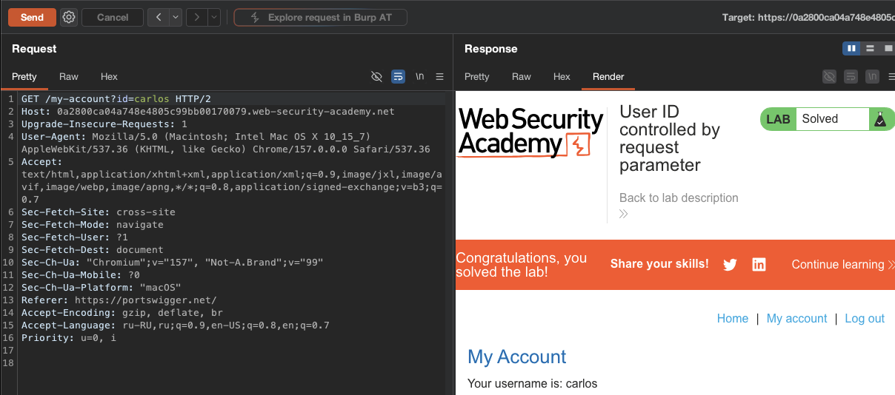

[AppSec Labs](../../README_EN.md)　 /　 Web Security

# IDOR · User Profile

**Recorded finding.** The server returned another test account’s profile. Reading a record requires a check that the current user is allowed to access that particular object.

PortSwigger Web Security Academy · Apprentice · Burp Suite Community

[Original screenshots](assets/) · [PortSwigger](https://portswigger.net/web-security/access-control/lab-user-id-controlled-by-request-parameter)

## Objective

Investigate user profile access controls and identify a vulnerability that allows an authenticated user to access another user's confidential information.

The objective was to obtain the API key belonging to the test user `carlos` while using the `wiener` account.

## Identified Vulnerability

**Type:** Insecure Direct Object Reference (IDOR).

**Category:** Broken Access Control.

**Mechanism:** Horizontal Privilege Escalation.

The application uses an `id` parameter in the URL to identify which user profile should be displayed.

However, the server does not properly verify whether the authenticated user is authorized to access the requested profile.

By modifying the `id` parameter, a user can access information belonging to another account with the same privilege level.

### Potential Impact

- Unauthorized access to other users' profiles.
- Disclosure of personal and confidential information.
- Exposure of API keys.
- Potential misuse of exposed keys, depending on their assigned permissions.

**Key finding:** The application accepts a client-controlled object identifier without enforcing sufficient object-level authorization.

## Tools Used

- **Burp Suite Community Edition** — manual application security testing.
- **Proxy → HTTP History** — inspection of HTTP traffic.
- **Repeater** — modification and replay of requests.
- **Burp Browser** — interaction with the training application.

## Testing Process

### Step 1. Authentication

Opened the training application using Burp Suite's built-in browser.

Logged in using the `wiener` test account provided by PortSwigger.

After successful authentication, navigated to **My Account**.

The account page displayed the username, API key, and email update functionality.

### Step 2. Identifying the Profile Parameter

Observed the following path in the browser:

`/my-account?id=wiener`

Inspected the corresponding request in **Proxy → HTTP History**.

Identified the `id` parameter as the mechanism used to select a user profile.

### Step 3. Testing Access Control

Sent the account request to **Burp Repeater**.

Original request:

`GET /my-account?id=wiener`

**Server Response:** `200 OK`.

Modified the `id` parameter to reference another test user:

`GET /my-account?id=carlos`

**Server Response:** `200 OK`.

### Step 4. Confirming the Vulnerability

After changing the parameter, the server returned the profile page belonging to `carlos`.

The response contained:

- The username `carlos`.
- The user's account information.
- An API key associated with that account.

This demonstrated that a user could obtain another account's confidential information by modifying a single request parameter.

The behavior confirmed an IDOR vulnerability.

### Step 5. Completing the Lab

The API key obtained within the authorized training environment was used to satisfy the lab objective.

PortSwigger confirmed successful completion with the **Lab Solved** status.

## Proof of Completion

The screenshot below demonstrates the modified profile request in Burp Suite Repeater and the successful lab result.

  

*Result: The carlos profile was accessible after modifying the id parameter. The lab was completed successfully. Sensitive values have been hidden.*

## Remediation Recommendations

1. **Authentication.** Identify the requesting user through a trusted server-side session or validated authentication token.
2. **Object-Level Authorization.** Verify that each user is permitted to access the specific requested resource.
3. **Access Restrictions.** Prevent ordinary users from accessing other accounts' confidential information.
4. **Server-Side Enforcement.** Never rely solely on client-side controls or user-supplied identifiers.
5. **Secure Error Handling.** Return an appropriate denial response, such as `403 Forbidden`, without disclosing unauthorized data.
6. **Automated Testing.** Add tests ensuring that changing a profile identifier does not expose another user's information.

Changing the HTTP method from GET to POST would not fix the vulnerability. Proper object-level authorization must be enforced on the server.

**Key principle:** Authentication establishes a user's identity, while authorization determines which resources that user is permitted to access.

## Result

**Lab successfully completed.**

### Skills Practiced

- HTTP request and URL parameter analysis.
- Working with Burp Suite Proxy and Repeater.
- Testing horizontal privilege boundaries.
- Identifying and confirming IDOR vulnerabilities.
- Analyzing confidential data exposure.
- Documenting application security findings.

**Independence level:** identified the key request parameter independently; completed the testing process with guided learning hints.

*All testing was performed exclusively within the authorized PortSwigger Web Security Academy environment. No real user data or secrets are published in this report.*

[Report catalogue](../../README_EN.md) · [Profile](https://github.com/mrjakeball/mrjakeball/blob/main/README_EN.md) · [Project catalogue](https://github.com/mrjakeball/portfolio/blob/main/README_EN.md)
