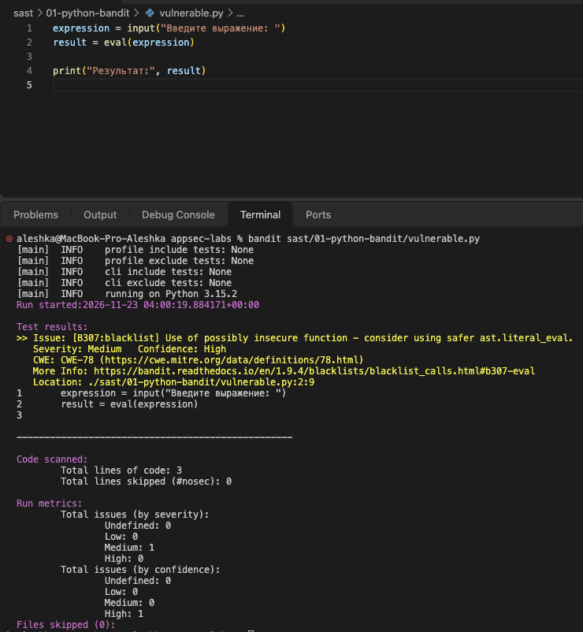
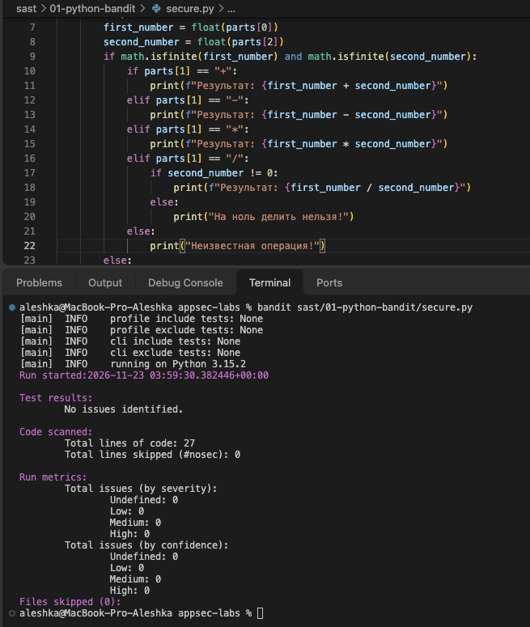

<a href="README.md"><picture><source media="(max-width: 600px)" srcset="https://raw.githubusercontent.com/mrjakeball/mrjakeball/main/assets/navigation/ru-on-compact.svg?v=3"></picture></a>
<a href="README_EN.md"><picture><source media="(max-width: 600px)" srcset="https://raw.githubusercontent.com/mrjakeball/mrjakeball/main/assets/navigation/en-off-compact.svg?v=3"></picture></a>
<a href="https://github.com/mrjakeball/portfolio"><picture><source media="(max-width: 600px)" srcset="https://raw.githubusercontent.com/mrjakeball/mrjakeball/main/assets/navigation/catalog-ru-compact.svg?v=3"></picture></a>

[AppSec Labs](../../README.md)　 /　 SAST

# Python eval() Security

**Результат работы.** Калькулятор перешёл от выполнения введённого выражения к разбору двух чисел и разрешённой операции. После исправления Bandit перестал выдавать B307.

[Исходные скриншоты](assets/) · [Исправленный код](secure.py)

## Цель

Изучить основы статического анализа безопасности (SAST), обнаружить потенциально опасное использование `eval()` в Python, исправить код и проверить результат с помощью Bandit и Semgrep.

## Инструменты

- Python 3.15.2
- Bandit 1.9.4
- Semgrep 1.167.0
- Visual Studio Code

## Обнаруженная проблема

**Файл:** `vulnerable.py`

Программа получает математическое выражение от пользователя и передаёт его в функцию `eval()`.

`eval()` интерпретирует переданную строку как Python-выражение. При обработке недоверенного ввода это может привести к выполнению непредусмотренного кода.

**Результат Bandit:**
- Rule ID: `B307`
- Severity: `Medium`
- Confidence: `High`
- CWE: `CWE-78`
- Location: `vulnerable.py`, строка 2

[Открыть оригинал](./assets/bandit-b307.png)

## Исправление

В файле `secure.py` использование `eval()` заменено контролируемым разбором выражения.

Реализованы:
- Разбиение ввода с помощью `split()`.
- Поддержка только четырёх арифметических операций.
- Преобразование чисел через `float()`.
- Обработка ошибок через `try/except ValueError`.
- Проверка деления на ноль.
- Проверка входных чисел через `math.isfinite()`.
- Отклонение неизвестных операций и неверного формата.

## Повторное сканирование

Команды:

- `bandit sast/01-python-bandit/vulnerable.py`
- `bandit sast/01-python-bandit/secure.py`
- `semgrep scan --lang python --pattern 'eval(...)' sast/01-python-bandit/`
- `semgrep scan --config p/python --metrics=off sast/01-python-bandit/`

**Результаты:**

| Проверка | Результат |
|---|---|
| Bandit — vulnerable.py | 1 предупреждение B307 |
| Bandit — secure.py | 0 предупреждений |
| Semgrep — шаблон `eval(...)` | 1 совпадение в vulnerable.py |
| Semgrep — набор `p/python` (151 правило) | 0 находок |

[Открыть оригинал](./assets/bandit-clean.png)

## Дополнительный ручной анализ

Во время тестирования обнаружено, что `float()` принимает специальные значения `nan` и `inf`. В исправленной версии добавлена проверка конечности входных чисел с помощью `math.isfinite()`.

При этом конечность входных чисел не гарантирует конечность результата очень больших вычислений. Это ограничение остаётся возможным направлением дальнейшего улучшения.

## Вывод

На практике изучены основы SAST-анализа, интерпретация предупреждений Bandit, работа с пользовательскими правилами Semgrep и повторная проверка после исправления.

Важный вывод: отсутствие предупреждений от сканера не гарантирует полной безопасности приложения. Автоматический анализ необходимо дополнять ручной проверкой и тестированием.

*Проект создан исключительно в учебных целях.*

[Каталог отчётов](../../README.md) · [Профиль](https://github.com/mrjakeball) · [Каталог проектов](https://github.com/mrjakeball/portfolio)
