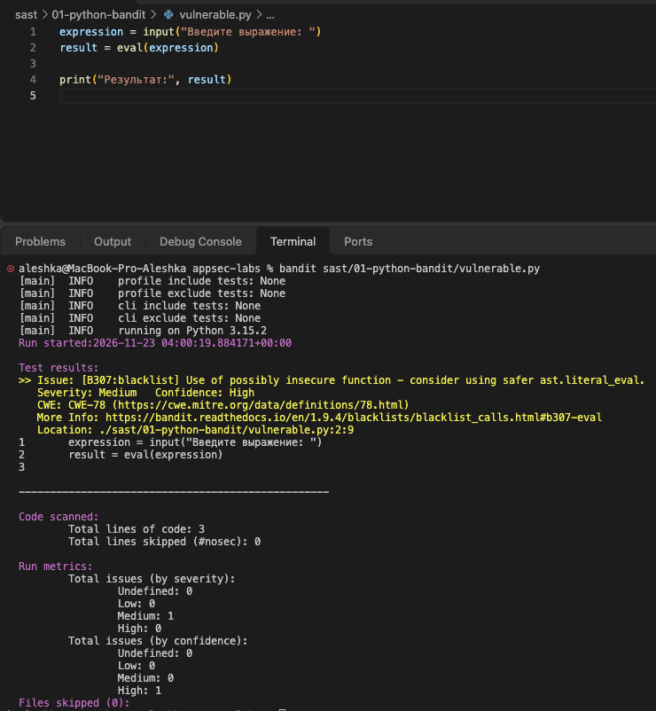
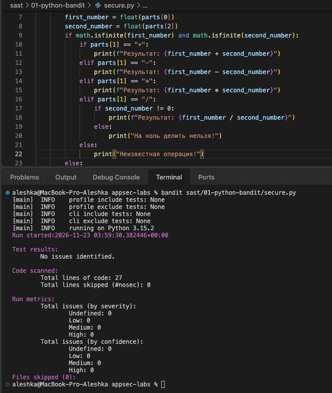

# SAST Lab 01 — Python Security Analysis (Bandit & Semgrep)

[🇷🇺 Русский](./README.md) | [🇬🇧 English](./README_EN.md)

## Objective

Learn the fundamentals of Static Application Security Testing (SAST), identify potentially unsafe use of Python's `eval()`, remediate the issue, and validate the changes using Bandit and Semgrep.

## Tools

- Python 3.15.2
- Bandit 1.9.4
- Semgrep 1.167.0
- Visual Studio Code

## Vulnerability

**File:** `vulnerable.py`

The application accepts a mathematical expression from the user and evaluates it using `eval()`.

Because `eval()` interprets a string as a Python expression, passing untrusted input to it can allow unintended code execution.

**Bandit finding:**
- Rule ID: `B307`
- Severity: `Medium`
- Confidence: `High`
- CWE: `CWE-78`
- Location: `vulnerable.py`, line 2

## Remediation

In `secure.py`, the use of `eval()` was replaced with explicit expression parsing.

The updated application includes:
- Input parsing with `split()`.
- Support for four allowed arithmetic operators.
- Numeric conversion using `float()`.
- Error handling with `try/except ValueError`.
- Division-by-zero protection.
- Input validation using `math.isfinite()`.
- Rejection of unknown operators and invalid expression formats.

## Validation

Commands executed:

- `bandit sast/01-python-bandit/vulnerable.py`
- `bandit sast/01-python-bandit/secure.py`
- `semgrep scan --lang python --pattern 'eval(...)' sast/01-python-bandit/`
- `semgrep scan --config p/python --metrics=off sast/01-python-bandit/`

**Results:**

| Scan | Result |
|---|---|
| Bandit — vulnerable.py | 1 B307 finding |
| Bandit — secure.py | 0 findings |
| Semgrep — custom `eval(...)` pattern | 1 finding in vulnerable.py |
| Semgrep — `p/python` ruleset (151 rules) | 0 findings |

## Additional Manual Testing

Manual testing revealed that `float()` accepts special values such as `nan` and `inf`. The remediated application now validates input numbers with `math.isfinite()`.

A remaining limitation is that arithmetic on very large finite operands can still produce a non-finite result.

## Conclusion

This exercise covered the SAST workflow: identifying an unsafe construct, reviewing scanner findings, implementing a safer solution, and validating the remediation.

A key lesson is that zero scanner findings do not prove an application is completely secure. Automated scanning should be combined with manual code review and testing.

*This project is intended for educational purposes only.*