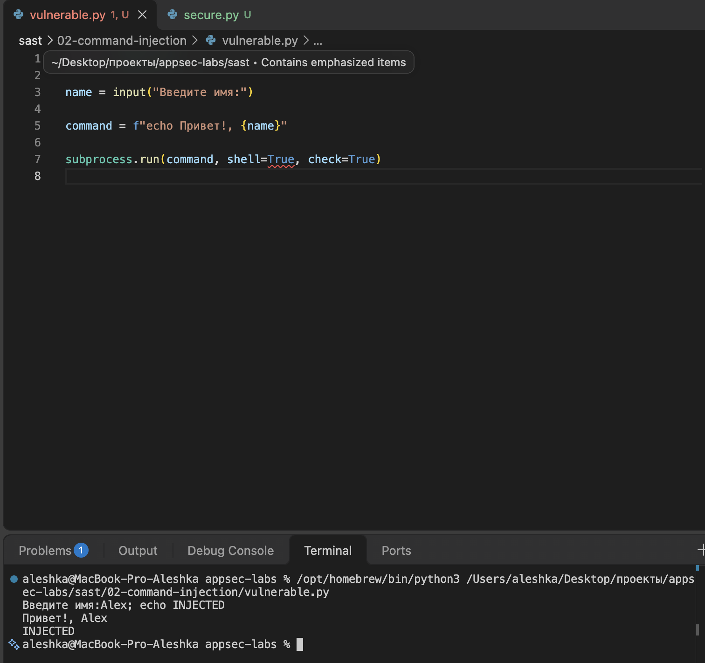
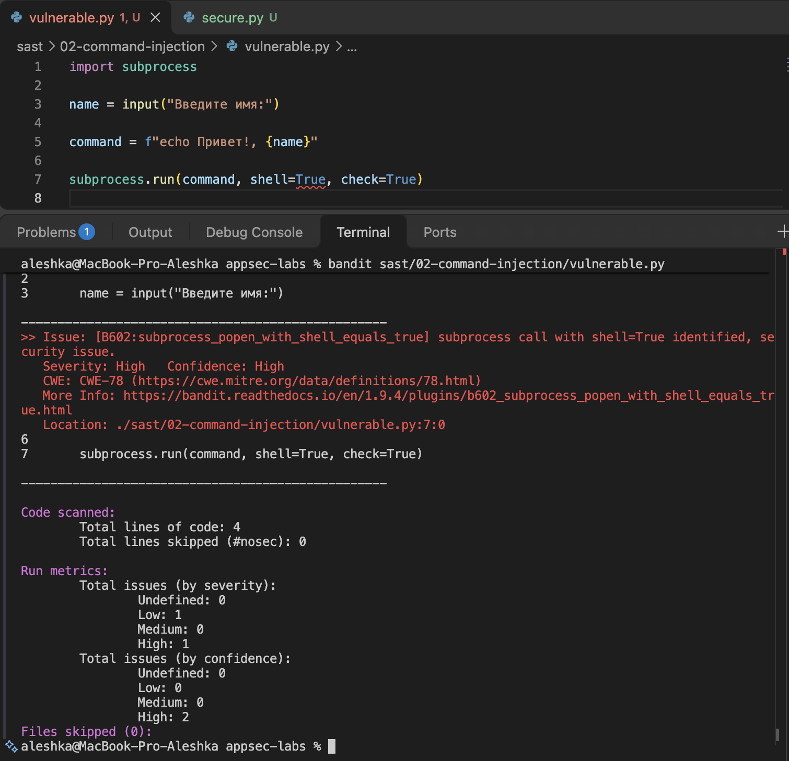
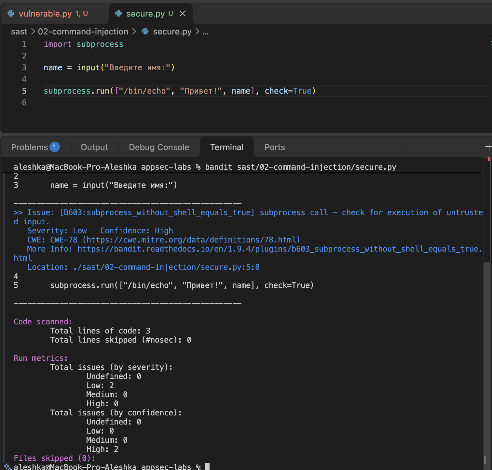
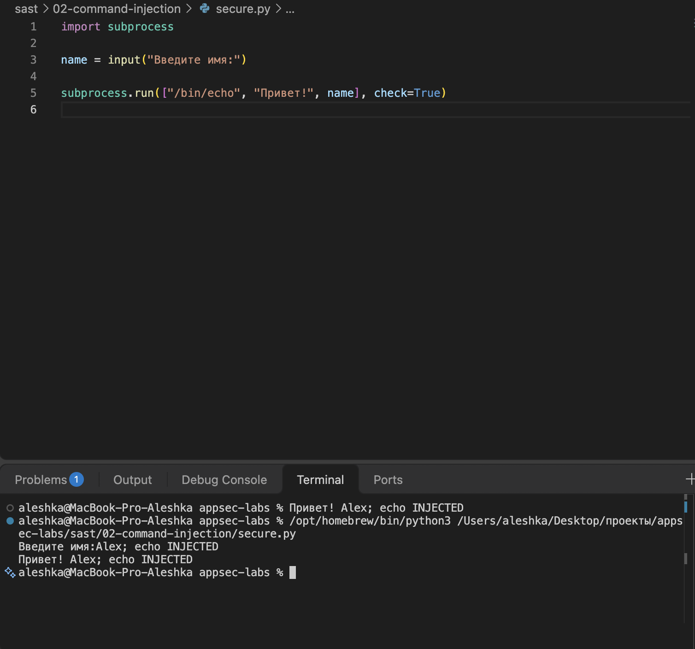

[AppSec Labs](../../README.md)　 /　 SAST

# OS Command Injection

**Результат работы.** После перехода к списку аргументов Bandit перестал выдавать B602. Два предупреждения низкой важности остались и разобраны отдельно.

[Исходные скриншоты](assets/) · [Исправленный код](secure.py)

## Цель

Изучить уязвимость OS Command Injection в Python, научиться обнаруживать её с помощью статического анализа (SAST), подтвердить возможность выполнения дополнительной системной команды и реализовать безопасный вариант запуска внешнего процесса.

## Инструменты

- Python 3.15.2
- Bandit 1.9.4
- Semgrep 1.167.0
- Visual Studio Code
- macOS

## Описание уязвимости

**Тип:** OS Command Injection

**CWE:** CWE-78 — Improper Neutralization of Special Elements used in an OS Command

**Файл:** `vulnerable.py`

**Уязвимая конструкция:** `subprocess.run(command, shell=True, check=True)`

Программа запрашивает имя пользователя, формирует системную команду `echo` с помощью f-строки и запускает её через `subprocess.run()`.

Проблема заключается в том, что пользовательский ввод включается в командную строку без безопасного разделения аргументов.

При использовании `shell=True` строка интерпретируется командной оболочкой. Специальные символы, введённые пользователем, могут изменить структуру команды и привести к выполнению дополнительных инструкций.

Параметр `check=True` позволяет обнаруживать ошибки завершения внешнего процесса, но не предотвращает Command Injection.

## Практическое подтверждение

**Тестовый ввод:**

`Alex; echo INJECTED`

**Полученный результат:**

- `Привет!, Alex`
- `INJECTED`

Символ `;` был интерпретирован оболочкой как разделитель команд.

В результате вместо одного приветствия программа выполнила две команды. Появление `INJECTED` на отдельной строке подтвердило возможность изменения поведения программы через пользовательский ввод.

[Открыть оригинал](./assets/injection-proof.png)

Тестирование проводилось исключительно на собственной локальной учебной программе. Использовалась безвредная дополнительная команда `echo`.

## Статический анализ — Bandit

Для проверки уязвимой версии использовалась команда:

`bandit sast/02-command-injection/vulnerable.py`

**Результаты анализа:**

| Правило | Severity | Confidence | Описание |
|---|---|---|---|
| B404 | Low | High | Потенциальные риски использования модуля subprocess |
| B602 | High | High | Запуск системной команды с shell=True |

Наиболее важной находкой стало правило **B602**.

Bandit определил потенциально опасное выполнение команды через системную оболочку и присвоил предупреждению уровень **High**.

Само использование модуля `subprocess` не означает наличие уязвимости. Однако сочетание `shell=True` с пользовательским вводом в данном случае создало подтверждённую Command Injection.

[Открыть оригинал](./assets/bandit-b602.png)

## Исправление

**Файл:** `secure.py`

Для устранения уязвимости изменён способ передачи команды в `subprocess.run()`.

В исправленной версии:

- Удалено использование `shell=True`.
- Команда и её аргументы передаются отдельными элементами списка.
- Используется абсолютный путь `/bin/echo` вместо поиска команды по имени через `PATH`.
- Сохранён параметр `check=True` для контроля ошибок выполнения.

Исправленный вызов:

`subprocess.run(["/bin/echo", "Привет!", name], check=True)`

Теперь введённое имя передаётся как отдельный аргумент программы, а не как часть командной строки, интерпретируемой оболочкой.

В реальном приложении, которому требуется только вывод приветствия, предпочтительнее использовать встроенную функцию `print()` и полностью отказаться от запуска внешнего процесса.

## Проверка после исправления

Для ручной проверки использовался тот же ввод:

`Alex; echo INJECTED`

**Результат исправленной версии:**

`Привет! Alex; echo INJECTED`

Теперь весь пользовательский ввод выводится как обычный текст. Дополнительная команда не выполняется.

[Открыть оригинал](./assets/injection-fixed.png)

## Повторный анализ Bandit

Команда:

`bandit sast/02-command-injection/secure.py`

**Результаты:**

| Правило | Severity | Confidence | Описание |
|---|---|---|---|
| B404 | Low | High | Предупреждение об использовании subprocess |
| B603 | Low | High | Рекомендация проверить безопасную передачу аргументов внешнему процессу |

После исправления предупреждение **B602 (High)** больше не обнаруживается.

Предупреждение **B607**, возникавшее при использовании короткого имени `echo`, также устранено благодаря указанию абсолютного пути `/bin/echo`.

Оставшиеся предупреждения B404 и B603 требуют анализа контекста, но не доказывают наличие эксплуатируемой уязвимости в данной реализации.

[Открыть оригинал](./assets/bandit-fixed.png)

## Анализ Semgrep

Для дополнительной проверки использовалось пользовательское правило поиска опасной конструкции:

`semgrep scan --lang python --pattern 'subprocess.run(..., shell=True)' sast/02-command-injection/`

**Результат:**

- Применено правил: 1
- Просканировано файлов: 2
- Найдено совпадений: 1
- Совпадение: `vulnerable.py`, строка 7
- В `secure.py` совпадений не обнаружено

Semgrep обнаружил вызов `subprocess.run()` с `shell=True` в уязвимой версии и не обнаружил эту конструкцию в исправленной.

Проверка использовала конкретный шаблон поиска, поэтому отсутствие совпадений не доказывает полную безопасность программы.

## Сравнение результатов

| Критерий | vulnerable.py | secure.py |
|---|---|---|
| Передача команды | Строка через shell | Список аргументов |
| shell=True | Да | Нет |
| Абсолютный путь к программе | Нет | Да |
| Выполнение дополнительной команды | Подтверждено | Не воспроизводится |
| Bandit High | 1 (B602) | 0 |
| Bandit Low | 1 (B404) | 2 (B404, B603) |
| Semgrep: shell=True | 1 совпадение | 0 совпадений |

## Рекомендации по безопасности

- По возможности не использовать системную оболочку для обработки пользовательских данных.
- Передавать команды и аргументы отдельными элементами списка.
- Не формировать исполняемые команды простым объединением строк с недоверенным вводом.
- Использовать абсолютные пути к исполняемым файлам, когда это целесообразно.
- Применять принцип минимальных привилегий.
- Дополнять автоматический анализ ручной проверкой поведения программы.
- Не считать отсутствие предупреждений SAST доказательством полной безопасности.

## Вывод

В ходе лабораторной работы была самостоятельно создана уязвимая Python-программа, позволяющая выполнить дополнительную системную команду через пользовательский ввод.

Уязвимость подтверждена ручным тестированием и обнаружена с помощью Bandit и Semgrep.

После исправления пользовательский ввод перестал интерпретироваться командной оболочкой. Повторная проверка показала устранение предупреждения высокой серьёзности B602.

Основной вывод: **при анализе безопасности важно не только количество предупреждений, но и понимание их причин, последствий и фактической возможности эксплуатации.**

*Лабораторная работа выполнена исключительно в образовательных целях на собственном локальном приложении.*

[Каталог отчётов](../../README.md) · [Профиль](https://github.com/mrjakeball) · [Каталог проектов](https://github.com/mrjakeball/portfolio)
