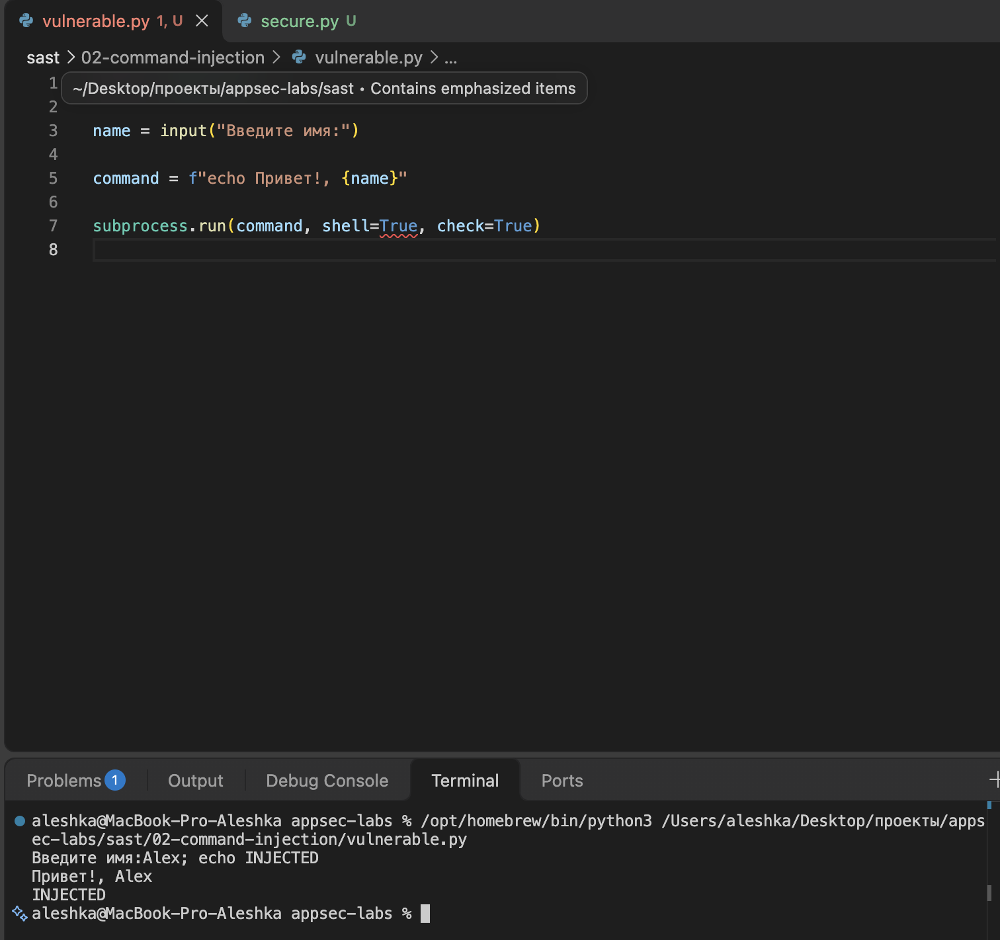
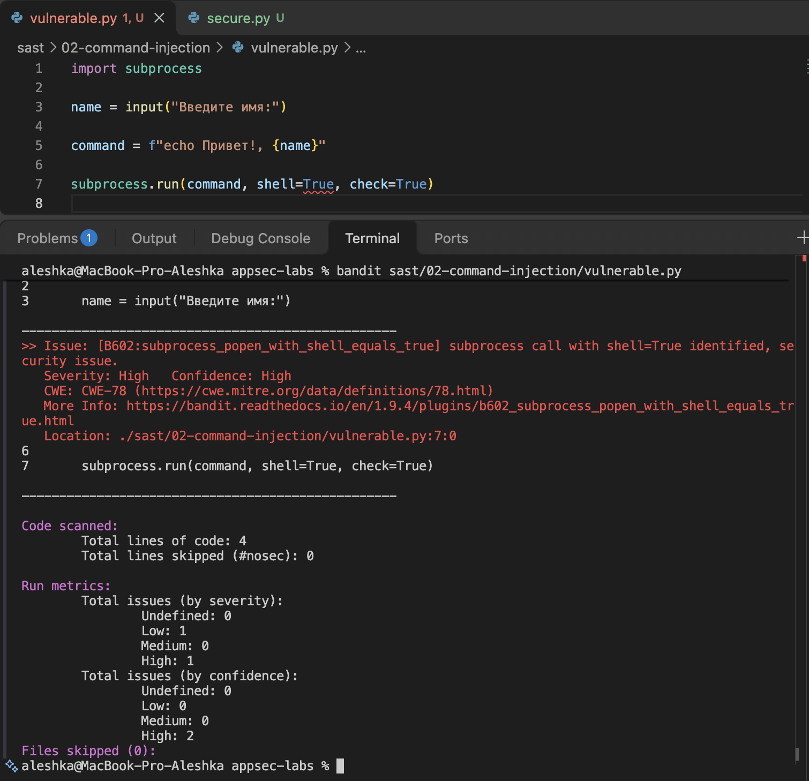
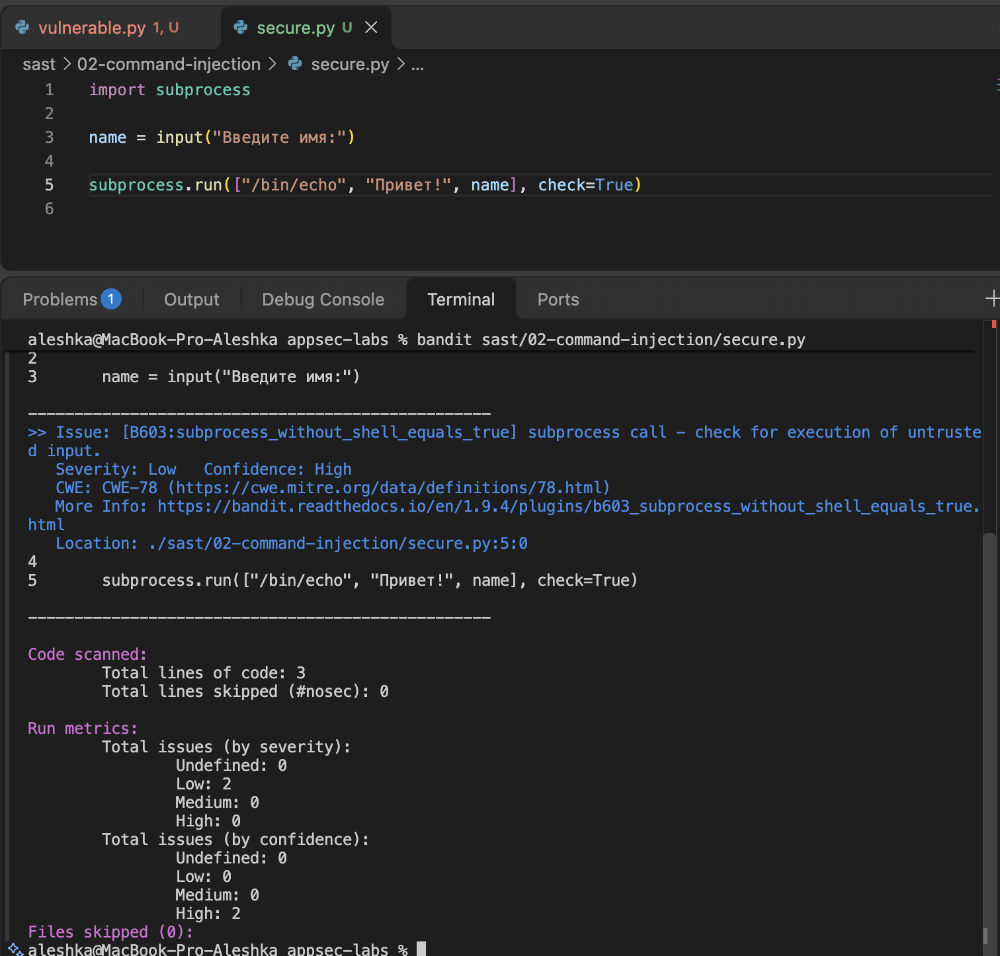
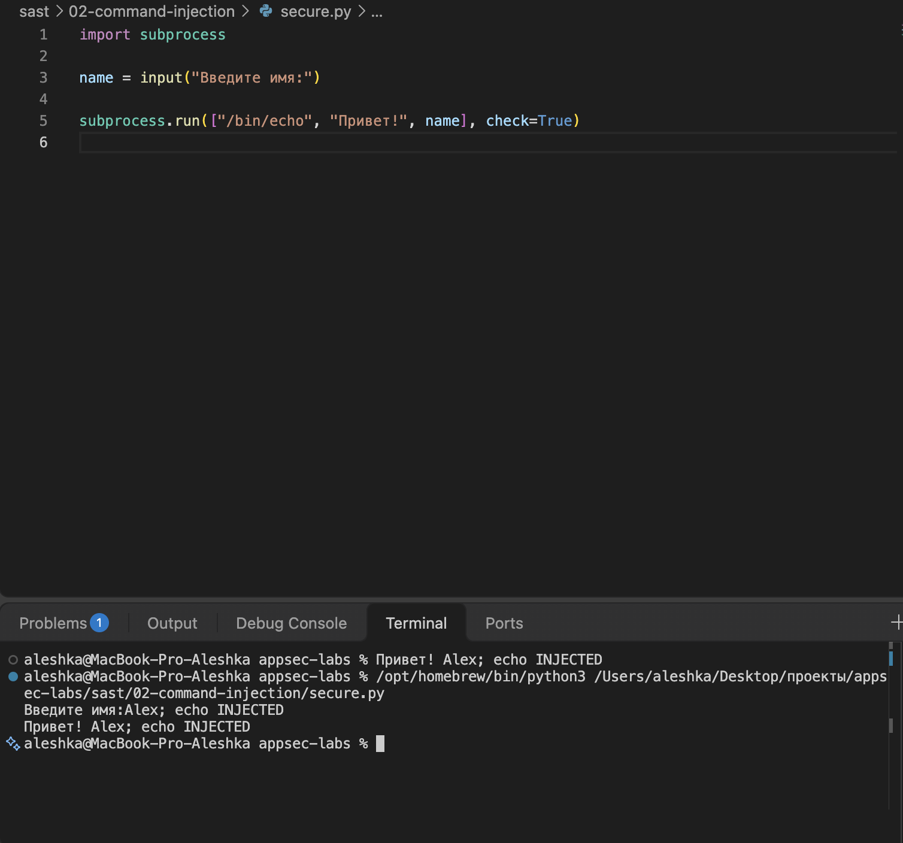

[AppSec Labs](../../README_EN.md)　 /　 SAST

# OS Command Injection

**Recorded finding.** After the change to an argument list, Bandit no longer reported B602. Two low-severity warnings remained and are documented separately.

[Original screenshots](assets/) · [Revised Python code](secure.py)

## Objective

Understand OS Command Injection in Python, detect potentially dangerous code using Static Application Security Testing (SAST), demonstrate unintended command execution, and implement a safer way to execute external programs.

## Tools

- Python 3.15.2
- Bandit 1.9.4
- Semgrep 1.167.0
- Visual Studio Code
- macOS

## Vulnerability Overview

**Vulnerability:** OS Command Injection

**CWE:** CWE-78 — Improper Neutralization of Special Elements used in an OS Command

**Affected file:** `vulnerable.py`

**Vulnerable code:** `subprocess.run(command, shell=True, check=True)`

The application accepts a username, constructs an `echo` command using an f-string, and executes it with `subprocess.run()`.

The vulnerability occurs because untrusted user input is inserted directly into a shell command.

When `shell=True` is enabled, the command string is interpreted by the operating system's shell. Special characters supplied by a user may alter the command structure and cause additional commands to execute.

The `check=True` parameter handles unsuccessful process exit codes but does not prevent command injection.

## Proof of Concept

**Test input:**

`Alex; echo INJECTED`

**Observed output:**

- `Привет!, Alex`
- `INJECTED`

The shell interpreted the semicolon as a command separator.

As a result, the application executed an additional `echo` command instead of treating the entire input as a username.

The separate `INJECTED` output demonstrated that user-controlled input could influence command execution.

[View original](./assets/injection-proof.png)

The proof of concept was performed exclusively against a locally developed educational application using a harmless `echo` command.

## Static Analysis — Bandit

The vulnerable file was analyzed using:

`bandit sast/02-command-injection/vulnerable.py`

**Findings:**

| Rule | Severity | Confidence | Description |
|---|---|---|---|
| B404 | Low | High | Potential security implications of subprocess usage |
| B602 | High | High | subprocess execution with shell=True |

The most significant finding was **B602**, classified as **High severity**.

Importing `subprocess` is not inherently a vulnerability. However, combining shell execution with untrusted input created an exploitable command injection issue in this application.

[View original](./assets/bandit-b602.png)

## Remediation

**Fixed file:** `secure.py`

The vulnerable shell invocation was replaced with an argument-list-based subprocess call.

The remediated implementation:

- Removes `shell=True`.
- Passes the executable and arguments as separate list elements.
- Uses the absolute executable path `/bin/echo`.
- Retains `check=True` for process error handling.

**Updated subprocess invocation:**

`subprocess.run(["/bin/echo", "Привет!", name], check=True)`

This approach passes user input directly as an argument to the intended executable without interpreting it as shell syntax.

For applications that only need to display a greeting, Python's built-in `print()` function is a simpler and preferable solution that avoids launching an external process entirely.

## Manual Remediation Validation

The same input was tested against the corrected application:

`Alex; echo INJECTED`

**Observed output:**

`Привет! Alex; echo INJECTED`

The complete input was treated as literal text. No additional shell command was executed.

[View original](./assets/injection-fixed.png)

## Bandit Rescan

The corrected implementation was analyzed using:

`bandit sast/02-command-injection/secure.py`

**Remaining findings:**

| Rule | Severity | Confidence | Description |
|---|---|---|---|
| B404 | Low | High | General warning about subprocess usage |
| B603 | Low | High | Review external process execution with untrusted arguments |

The **B602 High severity finding was eliminated**.

The earlier **B607** warning was also eliminated by replacing the partial executable name `echo` with its absolute path `/bin/echo`.

The remaining B404 and B603 findings are contextual warnings. They do not, by themselves, demonstrate an exploitable vulnerability in this implementation.

[View original](./assets/bandit-fixed.png)

## Semgrep Analysis

An additional Semgrep scan was performed using a custom pattern:

`semgrep scan --lang python --pattern 'subprocess.run(..., shell=True)' sast/02-command-injection/`

**Results:**

- Rules executed: 1
- Files scanned: 2
- Findings: 1
- Finding location: `vulnerable.py`, line 7
- Findings in `secure.py`: 0

Semgrep successfully identified the dangerous shell-enabled subprocess call in the vulnerable implementation.

Because the scan used a specific search pattern, zero findings in the corrected file do not prove that the entire application is free from vulnerabilities.

## Results Comparison

| Category | vulnerable.py | secure.py |
|---|---|---|
| Command execution | Shell command string | Argument list |
| shell=True | Yes | No |
| Absolute executable path | No | Yes |
| Additional command execution | Confirmed | Not reproduced |
| Bandit High findings | 1 (B602) | 0 |
| Bandit Low findings | 1 (B404) | 2 (B404, B603) |
| Semgrep shell=True findings | 1 | 0 |

## Security Recommendations

- Avoid shell execution when processing untrusted input.
- Prefer argument lists over dynamically constructed shell command strings.
- Do not concatenate untrusted input into executable commands.
- Use absolute executable paths when appropriate.
- Apply the principle of least privilege.
- Combine automated SAST scanning with manual security testing.
- Review findings in context rather than relying exclusively on warning counts.

## Conclusion

This lab demonstrated a complete application security testing workflow.

A vulnerable Python application was developed, OS Command Injection was reproduced through a harmless payload, and the issue was identified by Bandit and Semgrep.

The application was then modified to pass arguments directly to an external executable without shell interpretation.

Follow-up testing confirmed that the previous injection technique no longer worked, and Bandit no longer reported the High severity B602 finding.

**Key takeaway:** Effective application security requires understanding the root cause and actual exploitability of findings rather than simply attempting to eliminate every scanner warning.

*This lab was conducted solely for educational purposes against a self-developed local application.*

[Report catalogue](../../README_EN.md) · [Profile](https://github.com/mrjakeball/mrjakeball/blob/main/README_EN.md) · [Project catalogue](https://github.com/mrjakeball/portfolio/blob/main/README_EN.md)
